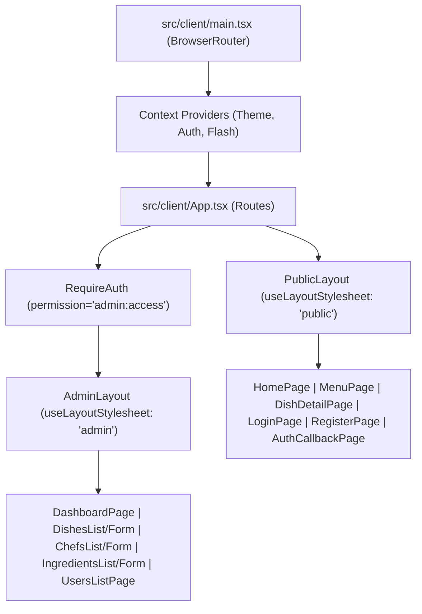

# Báo cáo Sử dụng AI (Phần 2) — Chuyển đổi Kiến trúc SSR sang CSR (Vite + React SPA & REST API)

- **Tác giả**: Phan Bình Khang (Andy Khang)
- **Môn học**: Kiến trúc Ứng dụng Web (Web Application Architecture) — HCMUS (Năm 3 / HK1)
- **Dự án**: Ứng dụng Web Nhà hàng Nhóm 13 — Nhánh `feat/csr` (React 19 CSR + Express 5 REST API)
- **Công cụ AI**: Antigravity (Google DeepMind Agentic AI Coding Assistant)
- **Ngày**: 19 tháng 10, 2026

---

## 1. Tóm tắt Tổng quan & Mục tiêu (Executive Summary & Objective)

Tài liệu này ghi lại quá trình lập trình cặp (pair-programming), phỏng vấn thiết kế kiến trúc và gỡ lỗi chuyên sâu giữa **Phan Bình Khang** cùng **Trợ lý AI Antigravity** nhằm thực hiện cuộc đại phẫu kiến trúc trên nhánh **`feat/csr`**: chuyển đổi toàn diện ứng dụng từ mô hình **Server-Side Rendering (SSR với Express + Handlebars)** sang mô hình **Client-Side Rendering (CSR với Vite + React 19 Single-Page Application)** kết hợp với **Backend REST API tách biệt hoàn toàn (Decoupled REST API)**.

### Các Mục tiêu & Ràng buộc Cốt lõi:
1. **Tách biệt hoàn toàn Backend thành REST API (`/api/*`)**: Loại bỏ toàn bộ cơ chế render HTML phía server (`res.render`, `express-handlebars`, `method-override`, flash cookies) và chuẩn hóa 100% phản hồi JSON theo cấu trúc đồng nhất:
   - Thành công: `{ ok: true, data: T }`
   - Thất bại: `{ ok: false, error: { code: 'UPPER_SNAKE_CASE', message: string, fields?: Record<string, string> } }`
2. **Chuyển đổi Giao diện sang React 19 + Vite SPA (`src/client/`)**: Chuyển đổi toàn bộ 28 tệp mẫu Handlebars (`.hbs` gồm layouts, partials, public pages, auth pages, admin pages, error pages) sang các React Function Components có kiểu dữ liệu chặt chẽ (TypeScript), sử dụng **React Router DOM v7** để điều hướng phía client (client-side routing).
3. **Kỷ luật Quản lý Nhánh Git**: Mọi thao tác phát triển, kiểm thử và commit chỉ được thực hiện trên nhánh **`feat/csr`**, tuyệt đối không chỉnh sửa hay ảnh hưởng tới nhánh `main`.

---

## 2. Giai đoạn 1: Phỏng vấn Thiết kế Kiến trúc Chuyên sâu (`/grill-me`)

Trước khi viết mã, phiên làm việc bắt đầu bằng quy trình phỏng vấn kiến trúc `/grill-me` để chốt toàn bộ các quyết định kỹ thuật quan trọng và lập bản kế hoạch chi tiết (`csr_migration_plan.md`):

### 2.1 Cấu trúc Kho mã nguồn & Quy trình Build (Repository & Build Layout)
- **Single Root `package.json`**: Giữ nguyên một tệp [`package.json`](file:///home/pbkhang404/Documents/HCMUS/Y3/S1/web/team13-restaurant/package.json) duy nhất ở thư mục gốc để dùng chung các kiểu dữ liệu TypeScript, cấu hình ESLint/Prettier và bộ kiểm thử Vitest.
- **Môi trường Phát triển (`npm run dev`)**: Chạy song song 3 tiến trình bằng `concurrently`:
  - `npm:dev:server`: Express API chạy trên cổng `3000` (`tsx watch src/server.ts`).
  - `npm:dev:client`: Vite Dev Server chạy trên cổng `5173` với Hot Module Replacement (HMR) và tự động proxy mọi request `/api` sang `http://localhost:3000`.
  - `npm:dev:css`: Trình biên dịch `@tailwindcss/cli` theo dõi và cập nhật `public/css/app.css`.
- **Môi trường Production (`npm run build` & `npm start`)**:
  - Vite đóng gói ứng dụng React SPA vào `dist/client/`.
  - TypeScript biên dịch mã nguồn máy chủ Express vào `dist/` (loại trừ `src/client` trong [`tsconfig.build.json`](file:///home/pbkhang404/Documents/HCMUS/Y3/S1/web/team13-restaurant/tsconfig.build.json)).
  - Máy chủ Express phục vụ các tài nguyên tĩnh trong `public/` và `dist/client/`, đồng thời chuyển hướng mọi request `GET` nhận HTML (không thuộc `/api`) về tệp SPA fallback `dist/client/index.html`.

### 2.2 Cơ chế Xác thực & Bảo mật CSRF cho SPA
- **Giữ nguyên HTTP-Only Cookie Auth**: Tiếp tục sử dụng `@supabase/ssr` lưu trữ session trong HTTP-only cookies để ngăn chặn nguy cơ đánh cắp token qua XSS (an toàn hơn lưu JWT trong `localStorage`).
- **Cầu nối CSRF (`csrf-csrf`)**: Endpoint khởi tạo `GET /api/auth/me` trả về `{ user, csrfToken }`. Phía React lưu `csrfToken` vào bộ nhớ module ([`src/client/lib/api.ts`](file:///home/pbkhang404/Documents/HCMUS/Y3/S1/web/team13-restaurant/src/client/lib/api.ts)) và tự động đính kèm vào header `x-csrf-token` cho mọi request làm thay đổi dữ liệu (`POST`, `PUT`, `PATCH`, `DELETE`).

### 2.3 Chuẩn hóa Cấu trúc Phản hồi JSON (Standardized JSON Response Envelope)
Thiết kế hợp đồng dữ liệu nghiêm ngặt giữa Backend và Frontend trong [`src/lib/http.ts`](file:///home/pbkhang404/Documents/HCMUS/Y3/S1/web/team13-restaurant/src/lib/http.ts) và [`src/client/lib/api.ts`](file:///home/pbkhang404/Documents/HCMUS/Y3/S1/web/team13-restaurant/src/client/lib/api.ts):

```ts
export type ApiErrorCode =
  | 'VALIDATION_ERROR'
  | 'INVALID_CREDENTIALS'
  | 'EMAIL_NOT_CONFIRMED'
  | 'AUTH_ERROR'
  | 'UNAUTHORIZED'
  | 'FORBIDDEN'
  | 'NOT_FOUND'
  | 'CONFLICT'
  | 'SELF_ROLE_CHANGE'
  | 'LAST_ADMIN'
  | 'RATE_LIMITED'
  | 'CSRF_INVALID'
  | 'UPLOAD_LIMIT_EXCEEDED'
  | 'INTERNAL_ERROR';

export type ApiSuccess<T> = {
  ok: true;
  data: T;
};

export type ApiFailure = {
  ok: false;
  error: {
    code: ApiErrorCode | string;
    message: string;
    fields?: Record<string, string>;
  };
};

export type ApiResponse<T> = ApiSuccess<T> | ApiFailure;
```

### 2.4 Cải tiến Luồng Xóa Quản trị & Cách ly CSS giữa các Layout
- **Thay thế Trang Xóa Rời rạc bằng Modal Xác nhận Nội tuyến**: Trong phiên bản SSR cũ, thao tác xóa phải chuyển hướng sang trang riêng (`/admin/dishes/:id/delete`). Trên bản CSR, luồng này được nâng cấp thành hộp thoại `<dialog>` hiện đại ([`ConfirmDeleteModal.tsx`](file:///home/pbkhang404/Documents/HCMUS/Y3/S1/web/team13-restaurant/src/client/components/shared/ConfirmDeleteModal.tsx)) ngay trên các trang danh sách, giúp xóa và cập nhật bảng tức thì mà không cần tải lại trang.
- **Cách ly Stylesheet Động (`useLayoutStylesheet`)**: Do `public/css/style.css` (trang công khai) và `public/css/admin.css` (trang quản trị) dùng chung nhiều tên class (`.btn`, `.search`, `.pager`, `body`), việc chuyển trang bằng React Router không tải lại `document.head` sẽ gây xung đột CSS nếu nạp cả hai cùng lúc. Giải pháp là xây dựng custom hook [`useLayoutStylesheet.ts`](file:///home/pbkhang404/Documents/HCMUS/Y3/S1/web/team13-restaurant/src/client/lib/useLayoutStylesheet.ts) tự động kích hoạt/vô hiệu hóa thẻ `<link rel="stylesheet">` tương ứng khi chuyển đổi giữa `PublicLayout` và `AdminLayout`.

---

## 3. Giai đoạn 2: Tách biệt Backend & Xây dựng Hệ thống REST API

### 3.1 Nâng cấp Hạ tầng HTTP & Middleware Bảo mật
- [`src/lib/http.ts`](file:///home/pbkhang404/Documents/HCMUS/Y3/S1/web/team13-restaurant/src/lib/http.ts): Mở rộng lớp `HttpError` để mang theo `code: ApiErrorCode` và `fields?: Record<string, string>`. Bổ sung bộ hàm phản hồi chuẩn `sendOk(res, data, status)` và `sendError(res, status, code, message, fields)`, cùng các factory `badRequest`, `unauthorized`, `forbidden`, `notFound`, `conflict`.
- [`src/middleware/rate-limit.ts`](file:///home/pbkhang404/Documents/HCMUS/Y3/S1/web/team13-restaurant/src/middleware/rate-limit.ts): Thay thế trang lỗi HTML khi vượt ngưỡng request bằng phản hồi JSON HTTP `429` với mã `RATE_LIMITED`.
- [`src/middleware/security.ts`](file:///home/pbkhang404/Documents/HCMUS/Y3/S1/web/team13-restaurant/src/middleware/security.ts): Cập nhật bộ xử lý upload `multer` để trả về JSON `413 UPLOAD_LIMIT_EXCEEDED` khi ảnh vượt quá 2 MB, xuất hàm `generateCsrfToken`, và loại bỏ middleware flash cookie cũ.
- [`src/auth/middleware.ts`](file:///home/pbkhang404/Documents/HCMUS/Y3/S1/web/team13-restaurant/src/auth/middleware.ts): Chuyển đổi `requireAuth` và `requirePermission` từ `res.redirect('/login')` sang ném lỗi `unauthorized()` (`401`) và `forbidden()` (`403`).
- [`src/app.ts`](file:///home/pbkhang404/Documents/HCMUS/Y3/S1/web/team13-restaurant/src/app.ts): Gỡ bỏ hoàn toàn `express-handlebars` và `method-override`. Gắn các router REST dưới tiền tố `/api`, trả về JSON `404 NOT_FOUND` cho mọi đường dẫn `/api/*` không tồn tại, bổ sung SPA fallback về `dist/client/index.html`, và chuẩn hóa Global Error Handler.

### 3.2 Ma trận Các Endpoint REST API Đã Hiện Thực Hóa

| Phân hệ | Phương thức & Đường dẫn | Quyền hạn | Mô tả Nghiệp vụ & Dữ liệu Trả về (`data`) |
| :--- | :--- | :---: | :--- |
| **Auth** | `GET /api/auth/me` | Công khai | Trả về `{ user: Profile \| null, csrfToken: string }` để khởi tạo trạng thái SPA. |
| **Auth** | `POST /api/auth/login` | Công khai | Đăng nhập email/mật khẩu; trả về `{ user, redirectTo, message }` hoặc mã lỗi `INVALID_CREDENTIALS`, `EMAIL_NOT_CONFIRMED`. |
| **Auth** | `POST /api/auth/register` | Công khai | Đăng ký tài khoản mới; hỗ trợ cả luồng xác nhận email và đăng nhập trực tiếp. |
| **Auth** | `POST /api/auth/logout` | Đã đăng nhập | Đăng xuất khỏi phiên Supabase và xóa cookie phiên. |
| **Auth** | `GET/POST /api/auth/callback` | Công khai | Xử lý mã xác thực PKCE (`code`) hoặc `token_hash` từ email xác nhận của Supabase. |
| **Public** | `GET /api/home` | Công khai | Trả về danh sách tối đa 8 món ăn nổi bật (`featured`) đang hoạt động. |
| **Public** | `GET /api/menu` | Công khai | Lọc thực đơn theo `category`, từ khóa `q`, sắp xếp `sort`, trả về cả danh sách nhóm (`groups`) và phẳng (`flat`). |
| **Public** | `GET /api/dishes/:slug` | Công khai | Chi tiết món ăn theo slug, thông tin đầu bếp và danh sách tên nguyên liệu. |
| **Admin** | `GET /api/admin/stats` | `admin:access` | Số liệu thống kê tổng quan (`dishCount`, `chefCount`, `ingredientCount`, `userCount`) và 5 món cập nhật gần nhất. |
| **Dishes** | `GET /api/admin/dishes` | `dish:create` | Danh sách món ăn có phân trang, tìm kiếm, lọc theo danh mục và trạng thái xóa mềm (`deleted=1`). |
| **Dishes** | `GET /api/admin/dishes/form-deps` | `dish:create` | Tải trước danh sách đầu bếp, nguyên liệu và danh mục cho biểu mẫu thêm/sửa món. |
| **Dishes** | `GET /api/admin/dishes/:id` | `dish:update` | Chi tiết món ăn kèm định lượng công thức (`dishIngredients`) và dữ liệu phụ thuộc. |
| **Dishes** | `POST /api/admin/dishes` | `dish:create` | Tạo món ăn mới (hỗ trợ `multipart/form-data` tải ảnh + mảng JSON nguyên liệu), tự sinh slug chống trùng. |
| **Dishes** | `PUT/PATCH /api/admin/dishes/:id` | `dish:update` | Cập nhật thông tin món ăn, ảnh đại diện và thay thế danh sách nguyên liệu trong transaction. |
| **Dishes** | `DELETE /api/admin/dishes/:id` | `dish:delete` | Xóa mềm món ăn (`deletedAt = new Date()`). |
| **Dishes** | `POST /api/admin/dishes/:id/restore` | `dish:restore` | Khôi phục món ăn đã xóa mềm (`deletedAt = null`). |
| **Chefs** | `GET/POST /api/admin/chefs` | `chef:create` | Danh sách đầu bếp có phân trang & tạo hồ sơ đầu bếp mới kèm tải ảnh chân dung. |
| **Chefs** | `GET/PUT/PATCH/DELETE /api/admin/chefs/:id` | `chef:update/delete` | Xem chi tiết, cập nhật, xóa mềm và khôi phục (`POST /:id/restore`) đầu bếp. |
| **Ingredients**| `GET/POST /api/admin/ingredients` | `ingredient:create` | Quản lý kho nguyên liệu, kiểm tra trùng tên (`409 CONFLICT`), tải ảnh minh họa. |
| **Ingredients**| `GET/PUT/PATCH/DELETE /api/admin/ingredients/:id`| `ingredient:update/delete` | Xem, cập nhật tồn kho/đơn giá, xóa mềm và khôi phục (`POST /:id/restore`) nguyên liệu. |
| **Users** | `GET /api/admin/users` | `user:manage` | Danh sách người dùng kèm bộ lọc tìm kiếm theo email hoặc tên hiển thị. |
| **Users** | `PATCH/POST /api/admin/users/:id/role` | `user:manage` | Thay đổi vai trò người dùng; chặn tự đổi vai trò (`SELF_ROLE_CHANGE`) và bảo vệ Admin cuối cùng (`LAST_ADMIN`). |

---

## 4. Giai đoạn 3: Hiện thực hóa Ứng dụng Frontend Vite + React 19 SPA

Toàn bộ giao diện người dùng được xây dựng mới trong thư mục `src/client/` với kiến trúc phân tách rõ ràng:



### 4.1 Các Module Tiện ích & React Context (`src/client/lib/` & `src/client/context/`)
- [`src/client/lib/api.ts`](file:///home/pbkhang404/Documents/HCMUS/Y3/S1/web/team13-restaurant/src/client/lib/api.ts): Hàm `apiFetch<T>(endpoint, options)` tự động chuẩn hóa đường dẫn `/api/...`, tự động gắn `Content-Type: application/json` cho object thường hoặc giữ nguyên boundary cho `FormData`, tự động đính kèm `x-csrf-token`, và ném ngoại lệ `ApiError` có chứa `status`, `code`, `message`, `fields` khi `json.ok === false`.
- [`src/client/context/AuthContext.tsx`](file:///home/pbkhang404/Documents/HCMUS/Y3/S1/web/team13-restaurant/src/client/context/AuthContext.tsx): Gọi `GET /api/auth/me` khi khởi chạy ứng dụng để đồng bộ thông tin `user` và lưu `csrfToken`, cung cấp các hàm `refreshAuth`, `setUser`, `logout`.
- [`src/client/context/FlashContext.tsx`](file:///home/pbkhang404/Documents/HCMUS/Y3/S1/web/team13-restaurant/src/client/context/FlashContext.tsx): Quản lý thông báo nổi (`success`, `error`, `info`) xuyên suốt các bước chuyển trang client-side và tự động ẩn sau 5 giây.
- [`src/client/context/ThemeContext.tsx`](file:///home/pbkhang404/Documents/HCMUS/Y3/S1/web/team13-restaurant/src/client/context/ThemeContext.tsx): Quản lý chế độ Sáng/Tối (`light` / `dark`), lưu vào `localStorage` và tích hợp hiệu ứng chuyển cảnh mượt mà qua `document.startViewTransition`.

### 4.2 Các Layout, Component Dùng chung & Trang Nghiệp vụ
- **Layouts**:
  - [`PublicLayout.tsx`](file:///home/pbkhang404/Documents/HCMUS/Y3/S1/web/team13-restaurant/src/client/components/layouts/PublicLayout.tsx): Thanh điều hướng công khai, nút chuyển đổi giao diện Sáng/Tối, ngăn kéo menu di động (mobile drawer), hiển thị `FlashBanner` và chân trang (`footer`).
  - [`AdminLayout.tsx`](file:///home/pbkhang404/Documents/HCMUS/Y3/S1/web/team13-restaurant/src/client/components/layouts/AdminLayout.tsx): Cột điều hướng quản trị bên trái (chuyển thành topbar dropdown trên thiết bị di động $< 960\text{px}$), tự động đóng menu khi chuyển route, nhấn phím `Escape` hoặc nhấp chuột ra ngoài.
- **Public & Auth Pages**:
  - [`HomePage.tsx`](file:///home/pbkhang404/Documents/HCMUS/Y3/S1/web/team13-restaurant/src/client/pages/public/HomePage.tsx): Tích hợp băng chuyền (carousel) món ăn nổi bật bằng React state, hỗ trợ phím mũi tên, vuốt cảm ứng (touch swipe), ảnh thu nhỏ xem trước (peek thumbnails) và thanh chữ chạy (ticker).
  - [`MenuPage.tsx`](file:///home/pbkhang404/Documents/HCMUS/Y3/S1/web/team13-restaurant/src/client/pages/public/MenuPage.tsx): Đồng bộ bộ lọc danh mục, từ khóa tìm kiếm và chế độ sắp xếp trực tiếp với URL query string thông qua `useSearchParams`.
  - [`DishDetailPage.tsx`](file:///home/pbkhang404/Documents/HCMUS/Y3/S1/web/team13-restaurant/src/client/pages/public/DishDetailPage.tsx): Hiển thị thông tin chi tiết món ăn, danh sách nguyên liệu và hộp thoại `<dialog>` giới thiệu tiểu sử đầu bếp phụ trách.
  - [`LoginPage.tsx`](file:///home/pbkhang404/Documents/HCMUS/Y3/S1/web/team13-restaurant/src/client/pages/auth/LoginPage.tsx), [`RegisterPage.tsx`](file:///home/pbkhang404/Documents/HCMUS/Y3/S1/web/team13-restaurant/src/client/pages/auth/RegisterPage.tsx), [`AuthCallbackPage.tsx`](file:///home/pbkhang404/Documents/HCMUS/Y3/S1/web/team13-restaurant/src/client/pages/auth/AuthCallbackPage.tsx): Xử lý xác thực không tải lại trang, phân nhánh hiển thị lỗi theo `err.code` (`EMAIL_NOT_CONFIRMED`, `INVALID_CREDENTIALS`, `VALIDATION_ERROR`).
- **Admin Portal Pages**:
  - [`DashboardPage.tsx`](file:///home/pbkhang404/Documents/HCMUS/Y3/S1/web/team13-restaurant/src/client/pages/admin/DashboardPage.tsx): Hiển thị 4 thẻ chỉ số thời gian thực và bảng các món ăn vừa cập nhật.
  - [`DishesListPage.tsx`](file:///home/pbkhang404/Documents/HCMUS/Y3/S1/web/team13-restaurant/src/client/pages/admin/dishes/DishesListPage.tsx) & [`DishFormPage.tsx`](file:///home/pbkhang404/Documents/HCMUS/Y3/S1/web/team13-restaurant/src/client/pages/admin/dishes/DishFormPage.tsx): Quản lý món ăn kèm trình tạo công thức động (thêm/xóa dòng nguyên liệu, tự động điền đơn vị tính khi chọn nguyên liệu).
  - [`ChefsListPage.tsx`](file:///home/pbkhang404/Documents/HCMUS/Y3/S1/web/team13-restaurant/src/client/pages/admin/chefs/ChefsListPage.tsx), [`ChefFormPage.tsx`](file:///home/pbkhang404/Documents/HCMUS/Y3/S1/web/team13-restaurant/src/client/pages/admin/chefs/ChefFormPage.tsx), [`IngredientsListPage.tsx`](file:///home/pbkhang404/Documents/HCMUS/Y3/S1/web/team13-restaurant/src/client/pages/admin/ingredients/IngredientsListPage.tsx), [`IngredientFormPage.tsx`](file:///home/pbkhang404/Documents/HCMUS/Y3/S1/web/team13-restaurant/src/client/pages/admin/ingredients/IngredientFormPage.tsx), [`UsersListPage.tsx`](file:///home/pbkhang404/Documents/HCMUS/Y3/S1/web/team13-restaurant/src/client/pages/admin/users/UsersListPage.tsx).

---

## 5. Giai đoạn 4: Gỡ lỗi Thực tế, Tinh chỉnh Kiểu Dữ liệu & Hoàn thiện Tài liệu

### 5.1 Khắc phục Triệt để Cảnh báo ESLint & Strict TypeScript
- **Vấn đề**: Khi chạy `npm run lint` và `npm run typecheck`, trình kiểm tra phát hiện các lỗi `@typescript-eslint/no-explicit-any` và lỗi ép kiểu `string | number` sang `string`.
- **Cách giải quyết**:
  1. Trong [`src/modules/ingredients/routes.ts`](file:///home/pbkhang404/Documents/HCMUS/Y3/S1/web/team13-restaurant/src/modules/ingredients/routes.ts): Thay kiểu `any` của biến `updatedIngredient` bằng kiểu suy diễn chính xác từ Prisma `Awaited<ReturnType<typeof prisma.ingredient.update>> | null`.
  2. Trong [`src/modules/users/routes.ts`](file:///home/pbkhang404/Documents/HCMUS/Y3/S1/web/team13-restaurant/src/modules/users/routes.ts): Khai báo tường minh `handleUpdateRole(req: Request, res: Response)` từ `express`.
  3. Trong [`src/client/pages/admin/dishes/DishFormPage.tsx`](file:///home/pbkhang404/Documents/HCMUS/Y3/S1/web/team13-restaurant/src/client/pages/admin/dishes/DishFormPage.tsx): Chuyển đổi an toàn `String(value)` cho các trường `ingredientId` và `unit` trong `updateIngredientRow`.
  4. Trong [`tests/http.test.ts`](file:///home/pbkhang404/Documents/HCMUS/Y3/S1/web/team13-restaurant/tests/http.test.ts) và [`tests/rate-limit.test.ts`](file:///home/pbkhang404/Documents/HCMUS/Y3/S1/web/team13-restaurant/tests/rate-limit.test.ts): Định nghĩa interface `MockResponse` thay vì dùng ép kiểu `as any`.

### 5.2 Chẩn đoán & Xử lý Lỗi `"chefId": "Invalid UUID"` Khi Thêm Món Ăn Mới
- **Phản hồi từ Người dùng**: Khi thử thêm món ăn mới trên giao diện quản trị và chọn "Đầu bếp phụ trách", máy chủ trả về lỗi:
  ```json
  {
    "error": {
      "code": "VALIDATION_ERROR",
      "message": "Thông tin món ăn không hợp lệ",
      "fields": {
        "chefId": "Invalid UUID"
      }
    }
  }
  ```
- **Phân tích Nguyên nhân Gốc rễ (Root Cause Analysis)**:
  1. *Sự khác biệt giữa chuẩn UUID RFC 4122 nghiêm ngặt của Zod 4 và kiểu `uuid` của PostgreSQL*: Trong Zod 4, hàm `z.uuid()` áp dụng biểu thức chính quy kiểm tra nghiêm ngặt bit phiên bản (version nibble `[1-8]`) và bit biến thể (variant `[89abAB]`):
     `/^([0-9a-fA-F]{8}-[0-9a-fA-F]{4}-[1-8][0-9a-fA-F]{3}-[89abAB][0-9a-fA-F]{3}-[0-9a-fA-F]{12}|...)$/`
  2. *Dữ liệu Seed Đầu bếp sử dụng UUID cố định (Deterministic Seeded UUIDs)*: Trong [`prisma/seed.ts`](file:///home/pbkhang404/Documents/HCMUS/Y3/S1/web/team13-restaurant/prisma/seed.ts), hai đầu bếp mẫu là **Gordon Ramsay** và **Christine Hà** được khởi tạo với ID cố định là `00000000-0000-0000-0000-000000000001` và `00000000-0000-0000-0000-000000000002`. Đối với PostgreSQL, bất kỳ chuỗi 32 ký tự thập lục phân nào theo định dạng `8-4-4-4-12` đều là kiểu `uuid` hợp lệ, nhưng `z.uuid()` của Zod 4 lại từ chối các UUID này vì nhóm thứ 3 và thứ 4 bắt đầu bằng chữ số `0`, sinh ra thông báo lỗi mặc định `"Invalid UUID"`.
  3. *Xử lý giá trị rỗng/null*: Hàm tiền xử lý `blankToUndefined` cũ chỉ kiểm tra chuỗi rỗng `""` mà chưa xử lý trường hợp giá trị `null` hoặc chuỗi `"null"` / `"undefined"`, đồng thời ở phía client khi bỏ chọn đầu bếp ("Chưa phân công") cần gửi rõ giá trị rỗng để có thể gỡ bỏ phân công đầu bếp khi cập nhật món.
- **Giải pháp & Hiện thực hóa**:
  1. Trong [`src/lib/validation.ts`](file:///home/pbkhang404/Documents/HCMUS/Y3/S1/web/team13-restaurant/src/lib/validation.ts):
     - Định nghĩa hằng số `UUID_RE = /^[0-9a-f]{8}-[0-9a-f]{4}-[0-9a-f]{4}-[0-9a-f]{4}-[0-9a-f]{12}$/i` đồng bộ 100% với quy tắc kiểm tra UUID của PostgreSQL và [`src/lib/admin.ts`](file:///home/pbkhang404/Documents/HCMUS/Y3/S1/web/team13-restaurant/src/lib/admin.ts).
     - Nâng cấp `blankToUndefined` để chuyển đổi an toàn cả `null`, `undefined`, chuỗi khoảng trắng và chuỗi `"null"` / `"undefined"` về `undefined`.
     - Xây dựng helper `uuid(label)` và `optionalUuid` sử dụng `UUID_RE` kèm thông báo lỗi tiếng Việt rõ nghĩa (`"Đầu bếp phụ trách không hợp lệ"`).
  2. Trong [`src/modules/dishes/routes.ts`](file:///home/pbkhang404/Documents/HCMUS/Y3/S1/web/team13-restaurant/src/modules/dishes/routes.ts): Cập nhật `DishIngredientItemSchema.ingredientId` sang dùng `uuid('Nguyên liệu')` và `DishSchema.chefId` dùng `optionalUuid`.
  3. Trong [`src/client/pages/admin/dishes/DishFormPage.tsx`](file:///home/pbkhang404/Documents/HCMUS/Y3/S1/web/team13-restaurant/src/client/pages/admin/dishes/DishFormPage.tsx): Luôn gửi `formData.append('chefId', chefId)` để hỗ trợ cả việc gán mới lẫn gỡ bỏ đầu bếp phụ trách.
  4. Bổ sung các bài kiểm thử đơn vị (regression tests) trong [`tests/http.test.ts`](file:///home/pbkhang404/Documents/HCMUS/Y3/S1/web/team13-restaurant/tests/http.test.ts) và [`tests/dish-ingredients.test.ts`](file:///home/pbkhang404/Documents/HCMUS/Y3/S1/web/team13-restaurant/tests/dish-ingredients.test.ts) để kiểm chứng cả UUID v4 ngẫu nhiên lẫn UUID cố định từ dữ liệu seed (`00000000-0000-0000-0000-000000000001`).

### 5.3 Cập nhật Tài liệu Dự án (`README.md`)
- Cập nhật toàn diện [`README.md`](file:///home/pbkhang404/Documents/HCMUS/Y3/S1/web/team13-restaurant/README.md) trên nhánh `feat/csr` để phản ánh kiến trúc React 19 CSR + Vite + Express 5 REST API, bảng tổng hợp các endpoint REST API, quy ước phản hồi JSON `{ ok, data, error }`, và hướng dẫn chạy môi trường phát triển đa tiến trình.

---

## 6. Kết quả Kiểm thử & Xác minh Chất lượng (Verification & QA)

Toàn bộ hệ thống sau khi chuyển đổi sang CSR đã vượt qua tất cả các bước kiểm tra tự động nghiêm ngặt:

| Hạng mục Kiểm tra | Lệnh Thực thi | Kết quả Chi tiết | Trạng thái |
| :--- | :--- | :--- | :---: |
| **Kiểm thử Đơn vị (Unit Tests)** | `npm test` | **7/7 tệp test**, **33/33 test cases** vượt qua 100% (`http.test.ts`, `dish-ingredients.test.ts`, `chef-validation.test.ts`, `admin-id.test.ts`, `permissions.test.ts`, `rate-limit.test.ts`, `slug.test.ts`). | ✅ **ĐẠT (33/33)** |
| **Kiểm tra Kiểu TypeScript** | `npm run typecheck` | `tsc --noEmit` kiểm tra đồng thời cả mã nguồn Backend và React Frontend (`jsx: "react-jsx"`) với **0 lỗi**. | ✅ **ĐẠT (0 Errors)** |
| **Kiểm tra Quy chuẩn Mã nguồn** | `npm run lint` | `eslint .` rà soát toàn bộ dự án với **0 lỗi, 0 cảnh báo**. | ✅ **ĐẠT (Clean)** |
| **Đóng gói Bản dựng Production** | `npm run build` | Biên dịch thành công Tailwind CSS v4 (`public/css/app.css`), gói Vite SPA (`dist/client/`) và máy chủ Express (`dist/`). | ✅ **ĐẠT (Success)** |

### Lịch sử Commit trên Nhánh `feat/csr`:
- `3590a25`: `feat(csr): migrate rendering from Handlebars SSR to Vite + React SPA with REST API`
- `fdc1710`: `chore: update package description for CSR`
- `b83bb9a`: `docs: update README for React CSR and REST API architecture`
- `40bc986`: `fix(dishes): support PostgreSQL and deterministic seeded UUIDs in chef and ingredient validation`

---

## 7. Đúc kết & Bài học Kinh nghiệm

1. **Sức mạnh của Hợp đồng API Đồng nhất (Standardized API Envelope)**: Việc thiết kế cấu trúc `{ ok, data, error: { code, message, fields } }` ngay từ giai đoạn phỏng vấn kiến trúc giúp hàm `apiFetch<T>()` ở phía React xử lý lỗi tập trung, vừa hiển thị được thông báo tổng quát vừa ánh xạ chính xác lỗi từng trường (`fields`) vào các biểu mẫu quản trị.
2. **Quản lý Xung đột CSS Khi Chuyển từ Multi-Page SSR sang Single-Page CSR**: Trong SSR, mỗi trang tải một tài liệu HTML độc lập nên `style.css` và `admin.css` không bao giờ chạm mặt nhau. Khi chuyển sang SPA, việc chủ động điều phối stylesheet theo vòng đời của Layout (`useLayoutStylesheet`) giúp giữ nguyên 100% giao diện gốc mà không cần viết lại hàng nghìn dòng CSS.
3. **Thận trọng với Sự Khác biệt Giữa Quy chuẩn Thư viện và Cơ sở Dữ liệu**: Sự cố `z.uuid()` trong Zod 4 từ chối các UUID cố định của PostgreSQL (`00000000-0000-0000-0000-000000000001`) là minh chứng điển hình cho việc cần đồng bộ quy tắc xác thực ở tầng ứng dụng với định dạng dữ liệu thực tế của hệ quản trị cơ sở dữ liệu.
