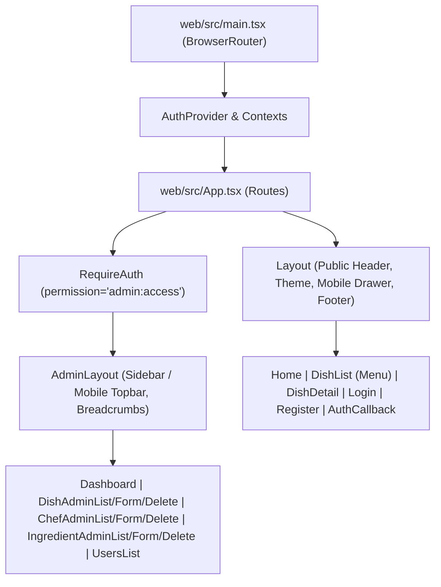

# Báo cáo Sử dụng AI (Phần 2) — Chuyển đổi Kiến trúc SSR sang CSR (Vite + React SPA & REST API)

- **Tác giả**: Phùng Bảo Khang (Andy Khang)
- **Môn học**: Kiến trúc Ứng dụng Web (Web Application Architecture) — HCMUS (Năm 3 / HK1)
- **Dự án**: Ứng dụng Web Nhà hàng Nhóm 13 — Nhánh `feat/csr` (React 19 CSR + Express 5 REST API)
- **Công cụ AI**: Antigravity (Google DeepMind Agentic AI Coding Assistant)
- **Ngày**: 19 tháng 10, 2026

---

## 1. Tóm tắt Tổng quan & Mục tiêu (Executive Summary & Objective)

Tài liệu này ghi lại toàn bộ quá trình lập trình cặp (pair-programming), phỏng vấn thiết kế kiến trúc và gỡ lỗi chuyên sâu giữa **Phùng Bảo Khang** cùng **Trợ lý AI Antigravity** nhằm thực hiện cuộc đại phẫu kiến trúc trên nhánh **`feat/csr`**: chuyển đổi toàn diện ứng dụng từ mô hình **Server-Side Rendering (SSR với Express + Handlebars)** sang mô hình **Client-Side Rendering (CSR với Vite + React 19 Single-Page Application)** kết hợp với **Backend REST API tách biệt hoàn toàn (Decoupled REST API)**.

### Các Mục tiêu & Ràng buộc Cốt lõi:
1. **Tách biệt hoàn toàn Backend thành REST API (`/api/*`)**: Loại bỏ toàn bộ cơ chế render HTML phía server (`res.render`, `express-handlebars`, `method-override`, flash cookies) và chuẩn hóa 100% phản hồi JSON theo cấu trúc đồng nhất:
   - Thành công: `{ ok: true, data: T }`
   - Thất bại: `{ ok: false, error: { code: 'UPPER_SNAKE_CASE', message: string, fields?: Record<string, string> } }`
2. **Chuyển đổi Giao diện sang React 19 + Vite SPA độc lập (`web/`)**: Chuyển đổi toàn bộ 28 tệp mẫu Handlebars (`.hbs` gồm layouts, partials, public pages, auth pages, admin pages, error pages) sang các React Function Components có kiểu dữ liệu chặt chẽ (TypeScript), sử dụng **React Router DOM v7** để điều hướng phía client (client-side routing).
3. **Cấu hình CORS Tường minh & Cookie Credentials**: Xây dựng middleware CORS toàn diện cho phép gọi trực tiếp cross-origin từ frontend Vite (`http://localhost:5173`) sang máy chủ Express (`http://localhost:3000`) đi kèm cookie xác thực và chống tấn công CSRF.
4. **Chuẩn hóa URL Tuyệt đối qua Phỏng vấn `/grill-me`**: Loại bỏ sự phụ thuộc vào Vite proxy, đưa vào biến môi trường `VITE_SERVER_URL` với cơ chế fail-fast và chuẩn hóa endpoint tuyệt đối.
5. **Kỷ luật Quản lý Nhánh Git**: Mọi thao tác phát triển, kiểm thử và commit chỉ được thực hiện trên nhánh **`feat/csr`**, tuyệt đối không chỉnh sửa hay ảnh hưởng tới nhánh `main`.

---

## 2. Giai đoạn 1: Phỏng vấn Thiết kế Kiến trúc Chuyển đổi SSR sang CSR (`/grill-me`)

Trước khi viết mã chuyển đổi, phiên làm việc bắt đầu bằng quy trình phỏng vấn kiến trúc `/grill-me` để chốt toàn bộ các quyết định kỹ thuật quan trọng và lập bản kế hoạch chi tiết (`csr_migration_plan.md`):

### 2.1 Cấu trúc Kho mã nguồn & Quy trình Build (Repository & Build Layout)
- **Tách biệt Mã nguồn Frontend & Backend**: Ban đầu frontend đặt tại `src/client/`, sau đó được tách hẳn thành thư mục độc lập `web/` với `package.json` và cấu hình Vite riêng để độc lập hóa vòng đời dependencies.
- **Môi trường Phát triển (`npm run dev`)**: Chạy song song các tiến trình bằng `concurrently`:
  - `npm:dev:server`: Express API chạy trên cổng `3000` (`tsx watch src/server.ts`).
  - `npm:dev:client`: Vite Dev Server chạy trên cổng `5173` với Hot Module Replacement (HMR).
  - `npm:dev:css`: Trình biên dịch CSS theo dõi và cập nhật stylesheet.
- **Môi trường Production (`npm run build` & `npm start`)**:
  - Vite đóng gói ứng dụng React SPA vào `dist/client/`.
  - TypeScript biên dịch mã nguồn máy chủ Express vào `dist/`.
  - Máy chủ Express phục vụ các tài nguyên tĩnh trong `public/` và `dist/client/`, đồng thời chuyển hướng mọi request `GET` nhận HTML (không thuộc `/api`) về tệp SPA fallback `dist/client/index.html`.

### 2.2 Cơ chế Xác thực & Bảo mật CSRF cho SPA
- **Giữ nguyên HTTP-Only Cookie Auth**: Tiếp tục sử dụng `@supabase/ssr` lưu trữ session trong HTTP-only cookies để ngăn chặn nguy cơ đánh cắp token qua XSS (an toàn hơn lưu JWT trong `localStorage`).
- **Cầu nối CSRF (`csrf-csrf`)**: Endpoint khởi tạo `GET /api/auth/me` trả về `{ user, csrfToken }`. Phía React lưu `csrfToken` vào bộ nhớ module ([`web/src/lib/api.ts`](file:///home/pbkhang404/Documents/HCMUS/Y3/S1/web/team13-restaurant/web/src/lib/api.ts)) và tự động đính kèm vào header `x-csrf-token` cho mọi request làm thay đổi dữ liệu (`POST`, `PUT`, `PATCH`, `DELETE`).

### 2.3 Chuẩn hóa Cấu trúc Phản hồi JSON (Standardized JSON Response Envelope)
Thiết kế hợp đồng dữ liệu nghiêm ngặt giữa Backend và Frontend trong [`src/lib/http.ts`](file:///home/pbkhang404/Documents/HCMUS/Y3/S1/web/team13-restaurant/src/lib/http.ts) và [`web/src/lib/api.ts`](file:///home/pbkhang404/Documents/HCMUS/Y3/S1/web/team13-restaurant/web/src/lib/api.ts):

```ts
export type ApiErrorCode =
  | 'VALIDATION_ERROR'
  | 'INVALID_CREDENTIALS'
  | 'EMAIL_NOT_CONFIRMED'
  | 'AUTH_ERROR'
  | 'UNAUTHORIZED'
  | 'FORBIDDEN'
  | 'NOT_FOUND'
  | 'CONFLICT'
  | 'SELF_ROLE_CHANGE'
  | 'LAST_ADMIN'
  | 'RATE_LIMITED'
  | 'CSRF_INVALID'
  | 'UPLOAD_LIMIT_EXCEEDED'
  | 'INTERNAL_ERROR';

export type ApiSuccess<T> = {
  ok: true;
  data: T;
};

export type ApiFailure = {
  ok: false;
  error: {
    code: ApiErrorCode | string;
    message: string;
    fields?: Record<string, string>;
  };
};

export type ApiResponse<T> = ApiSuccess<T> | ApiFailure;
```

### 2.4 Cải tiến Luồng Xóa Quản trị & Cách ly CSS giữa các Layout
- **Thay thế Trang Xóa Rời rạc bằng Modal Xác nhận Nội tuyến**: Trong phiên bản SSR cũ, thao tác xóa phải chuyển hướng sang trang riêng (`/admin/dishes/:id/delete`). Trên bản CSR, luồng này được nâng cấp thành hộp thoại `<dialog>` hiện đại ngay trên các trang danh sách, giúp xóa và cập nhật bảng tức thì mà không cần tải lại trang.
- **Cách ly Stylesheet Động**: Do `public.css` (trang công khai) và `admin.css` (trang quản trị) dùng chung nhiều tên class (`.btn`, `.search`, `.pager`, `body`), việc chuyển trang bằng React Router không tải lại `document.head` sẽ gây xung đột CSS nếu nạp cả hai cùng lúc. Việc đóng gói layout độc lập giúp giữ nguyên giao diện gốc mà không cần viết lại toàn bộ CSS.

---

## 3. Giai đoạn 2: Tách biệt Backend & Xây dựng Hệ thống REST API

### 3.1 Nâng cấp Hạ tầng HTTP & Middleware Bảo mật
- [`src/lib/http.ts`](file:///home/pbkhang404/Documents/HCMUS/Y3/S1/web/team13-restaurant/src/lib/http.ts): Mở rộng lớp `HttpError` để mang theo `code: ApiErrorCode` và `fields?: Record<string, string>`. Bổ sung bộ hàm phản hồi chuẩn `sendOk(res, data, status)` và `sendError(res, status, code, message, fields)`, cùng các factory `badRequest`, `unauthorized`, `forbidden`, `notFound`, `conflict`.
- [`src/middleware/rate-limit.ts`](file:///home/pbkhang404/Documents/HCMUS/Y3/S1/web/team13-restaurant/src/middleware/rate-limit.ts): Thay thế trang lỗi HTML khi vượt ngưỡng request bằng phản hồi JSON HTTP `429` với mã `RATE_LIMITED`.
- [`src/middleware/security.ts`](file:///home/pbkhang404/Documents/HCMUS/Y3/S1/web/team13-restaurant/src/middleware/security.ts): Cập nhật bộ xử lý upload `multer` để trả về JSON `413 UPLOAD_LIMIT_EXCEEDED` khi ảnh vượt quá 2 MB, xuất hàm `generateCsrfToken`, và loại bỏ middleware flash cookie cũ.
- [`src/auth/middleware.ts`](file:///home/pbkhang404/Documents/HCMUS/Y3/S1/web/team13-restaurant/src/auth/middleware.ts): Chuyển đổi `requireAuth` và `requirePermission` từ `res.redirect('/login')` sang ném lỗi `unauthorized()` (`401`) và `forbidden()` (`403`).
- [`src/app.ts`](file:///home/pbkhang404/Documents/HCMUS/Y3/S1/web/team13-restaurant/src/app.ts): Gỡ bỏ hoàn toàn `express-handlebars` và `method-override`. Gắn các router REST dưới tiền tố `/api`, trả về JSON `404 NOT_FOUND` cho mọi đường dẫn `/api/*` không tồn tại, bổ sung SPA fallback về `dist/client/index.html`, và chuẩn hóa Global Error Handler.

### 3.2 Ma trận Các Endpoint REST API Đã Hiện Thực Hóa

| Phân hệ | Phương thức & Đường dẫn | Quyền hạn | Mô tả Nghiệp vụ & Dữ liệu Trả về (`data`) |
| :--- | :--- | :---: | :--- |
| **Auth** | `GET /api/auth/me` | Công khai | Trả về `{ user: Profile \| null, csrfToken: string }` để khởi tạo trạng thái SPA. |
| **Auth** | `POST /api/auth/login` | Công khai | Đăng nhập email/mật khẩu; trả về `{ user, redirectTo, message }` hoặc mã lỗi `INVALID_CREDENTIALS`, `EMAIL_NOT_CONFIRMED`. |
| **Auth** | `POST /api/auth/register` | Công khai | Đăng ký tài khoản mới; hỗ trợ cả luồng xác nhận email và đăng nhập trực tiếp. |
| **Auth** | `POST /api/auth/logout` | Đã đăng nhập | Đăng xuất khỏi phiên Supabase và xóa cookie phiên. |
| **Auth** | `GET/POST /api/auth/callback` | Công khai | Xử lý mã xác thực PKCE (`code`) hoặc `token_hash` từ email xác nhận của Supabase. |
| **Public** | `GET /api/home` | Công khai | Trả về danh sách tối đa 8 món ăn nổi bật (`featured`) đang hoạt động. |
| **Public** | `GET /api/menu` | Công khai | Lọc thực đơn theo `category`, từ khóa `q`, sắp xếp `sort`, trả về cả danh sách nhóm (`groups`) và phẳng (`flat`). |
| **Public** | `GET /api/dishes/:slug` | Công khai | Chi tiết món ăn theo slug, thông tin đầu bếp và danh sách tên nguyên liệu. |
| **Admin** | `GET /api/admin/stats` | `admin:access` | Số liệu thống kê tổng quan (`dishCount`, `chefCount`, `ingredientCount`, `userCount`) và 5 món cập nhật gần nhất. |
| **Dishes** | `GET /api/admin/dishes` | `dish:create` | Danh sách món ăn có phân trang, tìm kiếm, lọc theo danh mục và trạng thái xóa mềm (`deleted=1`). |
| **Dishes** | `GET /api/admin/dishes/form-deps` | `dish:create` | Tải trước danh sách đầu bếp, nguyên liệu và danh mục cho biểu mẫu thêm/sửa món. |
| **Dishes** | `GET /api/admin/dishes/:id` | `dish:update` | Chi tiết món ăn kèm định lượng công thức (`dishIngredients`) và dữ liệu phụ thuộc. |
| **Dishes** | `POST /api/admin/dishes` | `dish:create` | Tạo món ăn mới (hỗ trợ `multipart/form-data` tải ảnh + mảng JSON nguyên liệu), tự sinh slug chống trùng. |
| **Dishes** | `PUT/PATCH /api/admin/dishes/:id` | `dish:update` | Cập nhật thông tin món ăn, ảnh đại diện và thay thế danh sách nguyên liệu trong transaction. |
| **Dishes** | `DELETE /api/admin/dishes/:id` | `dish:delete` | Xóa mềm món ăn (`deletedAt = new Date()`). |
| **Dishes** | `POST /api/admin/dishes/:id/restore` | `dish:restore` | Khôi phục món ăn đã xóa mềm (`deletedAt = null`). |
| **Chefs** | `GET/POST /api/admin/chefs` | `chef:create` | Danh sách đầu bếp có phân trang & tạo hồ sơ đầu bếp mới kèm tải ảnh chân dung. |
| **Chefs** | `GET/PUT/PATCH/DELETE /api/admin/chefs/:id` | `chef:update/delete` | Xem chi tiết, cập nhật, xóa mềm và khôi phục (`POST /:id/restore`) đầu bếp. |
| **Ingredients**| `GET/POST /api/admin/ingredients` | `ingredient:create` | Quản lý kho nguyên liệu, kiểm tra trùng tên (`409 CONFLICT`), tải ảnh minh họa. |
| **Ingredients**| `GET/PUT/PATCH/DELETE /api/admin/ingredients/:id`| `ingredient:update/delete` | Xem, cập nhật tồn kho/đơn giá, xóa mềm và khôi phục (`POST /:id/restore`) nguyên liệu. |
| **Users** | `GET /api/admin/users` | `user:manage` | Danh sách người dùng kèm bộ lọc tìm kiếm theo email hoặc tên hiển thị. |
| **Users** | `PATCH/POST /api/admin/users/:id/role` | `user:manage` | Thay đổi vai trò người dùng; chặn tự đổi vai trò (`SELF_ROLE_CHANGE`) và bảo vệ Admin cuối cùng (`LAST_ADMIN`). |

---

## 4. Giai đoạn 3: Hiện thực hóa Ứng dụng Frontend Vite + React 19 SPA (`web/`)

Toàn bộ giao diện người dùng được tổ chức trong thư mục độc lập `web/` với kiến trúc rõ ràng:



### 4.1 Các Module Khách & React Context (`web/src/lib/` & `web/src/auth/`)
- [`web/src/lib/api.ts`](file:///home/pbkhang404/Documents/HCMUS/Y3/S1/web/team13-restaurant/web/src/lib/api.ts): Hàm `apiFetch<T>(path, options)` kết nối trực tiếp tới `${SERVER_URL}/api`, tự động đính kèm `x-csrf-token`, xử lý retry cho request idempotent khi server khởi động lại (`TRANSIENT_STATUS`), và ném lỗi `ApiError` hoặc `HttpError`.
- [`web/src/lib/resources.ts`](file:///home/pbkhang404/Documents/HCMUS/Y3/S1/web/team13-restaurant/web/src/lib/resources.ts): Đóng gói toàn bộ các cuộc gọi API cho món ăn (`dishesApi`), đầu bếp (`chefsApi`), nguyên liệu (`ingredientsApi`) và xác thực (`authApi`).
- [`web/src/auth/AuthProvider.tsx`](file:///home/pbkhang404/Documents/HCMUS/Y3/S1/web/team13-restaurant/web/src/auth/AuthProvider.tsx): Quản lý phiên làm việc của người dùng thông qua `authApi.me()`, cập nhật CSRF token và đồng bộ trạng thái đăng nhập toàn ứng dụng.
- [`web/src/components/ThemeSwitch.tsx`](file:///home/pbkhang404/Documents/HCMUS/Y3/S1/web/team13-restaurant/web/src/components/ThemeSwitch.tsx): Quản lý chế độ Sáng/Tối (`light` / `dark`), lưu vào `localStorage` và chuyển cảnh mượt mà qua `document.startViewTransition`.

---

## 5. Giai đoạn 4: Hoàn thiện CORS, Tách biệt Thư mục Frontend & Phỏng vấn `/grill-me` Chuẩn hóa Server URL

Sau khi hoàn thành bộ khung CSR cơ bản, dự án bước vào giai đoạn tinh chỉnh sâu về kiến trúc mạng và cấu hình triển khai thông qua các buổi làm việc kỹ thuật cao:

### 5.1 Xây dựng Middleware CORS Toàn diện & Giải quyết Triệt để Kiểm thử QA Backend
- **Bối cảnh & Vấn đề**: Trong quá trình thực hiện kiểm thử hồi quy và chạy bộ 73 ca kiểm thử QA backend ([`reports/backend-testing/test_cases.md`](file:///home/pbkhang404/Documents/HCMUS/Y3/S1/web/team13-restaurant/reports/backend-testing/test_cases.md)), 2 ca kiểm thử CORS đã bị thất bại do máy chủ chưa cấu hình middleware phản hồi preflight `OPTIONS` và chưa cho phép origin của Vite frontend.
- **Giải pháp Hiện thực hóa** ([`src/middleware/cors.ts`](file:///home/pbkhang404/Documents/HCMUS/Y3/S1/web/team13-restaurant/src/middleware/cors.ts)):
  1. Sử dụng thư viện `cors` cấu hình trước middleware CSRF để đảm bảo request `OPTIONS` luôn được trả về HTTP 200 trước khi chạm vào bộ kiểm tra CSRF token.
  2. Xây dựng hàm `isAllowedOrigin(origin)` linh hoạt:
     - Tự động cho phép các request không có header `Origin` (same-origin, curl, server-to-server).
     - Cho phép origin chính của ứng dụng (`APP_URL`).
     - Hỗ trợ danh sách origin mở rộng qua biến môi trường `SPA_ORIGIN` (chấp nhận cả alias `CORS_ORIGIN`).
     - Trong môi trường phát triển (`!isProd`), sử dụng biểu thức chính quy tự động chấp thuận mọi cổng của `localhost` và `127.0.0.1` (`/^https?:\/\/localhost(:\d+)?$/`, `/^https?:\/\/127\.0\.0\.1(:\d+)?$/`).
  3. Bật cấu hình `credentials: true` để trình duyệt gửi cookie xác thực và cookie CSRF.
  4. Cấu hình danh sách header cho phép (`allowedHeaders`) và công khai (`exposedHeaders`) chứa `x-csrf-token`.
- **Kết quả**: Tất cả **73/73 test cases** trong báo cáo QA backend chuyển sang trạng thái **PASS** hoàn toàn.

### 5.2 Tách Thư mục Frontend Độc lập (`web/`) & Tối ưu Responsive
- Nhằm chuẩn hóa cấu trúc dự án chuẩn công nghiệp, toàn bộ mã nguồn React được di chuyển từ `src/client/` sang thư mục con chuyên biệt `web/` với `package.json`, TypeScript, Tailwind CSS v4 (`@tailwindcss/vite`) và Vite v6 riêng.
- Cải thiện trải nghiệm trên thiết bị di động ([`web/src/styles/public.css`](file:///home/pbkhang404/Documents/HCMUS/Y3/S1/web/team13-restaurant/web/src/styles/public.css) và [`web/src/styles/admin.css`](file:///home/pbkhang404/Documents/HCMUS/Y3/S1/web/team13-restaurant/web/src/styles/admin.css)):
  - Hỗ trợ ngăn kéo di động (mobile nav drawer) cho giao diện khách hàng.
  - Tự động chuyển đổi sidebar quản trị sang dropdown topbar khi chiều rộng màn hình $< 960\text{px}$.
  - Bổ sung thanh cuộn ngang mượt mà cho bảng dữ liệu quản trị để không bị vỡ layout trên điện thoại.

### 5.3 Phỏng vấn Thiết kế Kiến trúc `/grill-me`: Chuyển đổi Đường dẫn Tương đối sang Tuyệt đối với `VITE_SERVER_URL`
Nhận thấy việc sử dụng đường dẫn tương đối `/api` dựa vào proxy phát triển của Vite (`web/vite.config.ts`) tạo ra sự phụ thuộc ngầm và khó khăn khi triển khai frontend và backend trên các máy chủ/domain khác nhau, **Phùng Bảo Khang** đã kích hoạt lệnh `/grill-me` để phỏng vấn thiết kế nhằm chuẩn hóa việc gọi API.

Quy trình phỏng vấn diễn ra qua các bước giải quyết từng nhánh của cây thiết kế:

#### Vòng 1: Cấu trúc Biến Môi trường Server URL
- **Câu hỏi**: *Cấu trúc biến môi trường cho URL máy chủ nên được đặt như thế nào?*
- **Quyết định chốt**: Sử dụng `VITE_SERVER_URL` (ví dụ `http://localhost:3000`). Phía client sẽ tự động nối thêm tiền tố `/api` để xây dựng URL tuyệt đối, giúp phân định rõ ràng giữa địa chỉ máy chủ gốc và tiền tố định tuyến API.

#### Vòng 2: Cơ chế Xử lý khi Thiếu Biến Môi trường (Fallback Policy)
- **Câu hỏi**: *Ứng dụng nên phản ứng thế nào nếu `VITE_SERVER_URL` không được khai báo?*
- **Quyết định chốt**: Bắt buộc phải khai báo tường minh `VITE_SERVER_URL`; ném lỗi (throw error) ngay lập tức nếu thiếu biến môi trường này để áp dụng nguyên lý Fail-Fast, tránh việc ứng dụng chạy âm thầm với cấu hình sai lệch.

#### Vòng 3: Số phận của Biến Cũ `VITE_API_URL`
- **Câu hỏi**: *Nên thay thế hoàn toàn hay giữ `VITE_API_URL` làm giá trị ghi đè (override)?*
- **Quyết định chốt**: Thay thế hoàn toàn `VITE_API_URL` bằng `VITE_SERVER_URL` trong tài liệu mẫu `.env.example`, trong mã nguồn và cả thông báo lỗi trên UI để đảm bảo tính nhất quán tuyệt đối.

#### Vòng 4: Cấu hình Proxy của Vite trong `web/vite.config.ts`
- **Câu hỏi**: *Khi frontend đã gọi trực tiếp tới URL máy chủ tuyệt đối, cấu hình proxy `/api` trong `vite.config.ts` nên giữ hay bỏ?*
- **Quyết định chốt**: Gỡ bỏ hoàn toàn khối proxy `/api` trong `web/vite.config.ts`. Trình duyệt sẽ gửi request cross-origin trực tiếp tới cổng backend thông qua cơ chế CORS đã thiết lập ở mục 5.1.

#### Vòng 5: Quản lý Tệp Môi trường Cục bộ
- **Câu hỏi**: *Có nên tự động tạo tệp `web/.env` cục bộ hay không?*
- **Quyết định chốt**: Chỉ cập nhật tệp mẫu `web/.env.example` và tài liệu hướng dẫn; không tự ý tạo tệp `web/.env` trên máy để tuân thủ kỷ luật quản lý cấu hình của dự án.

#### Vòng 6: Thời điểm Bắt lỗi Thiếu Cấu hình
- **Câu hỏi**: *Lỗi thiếu `VITE_SERVER_URL` nên được ném ra khi nào?*
- **Quyết định chốt**: Ném lỗi ngay khi module [`web/src/lib/api.ts`](file:///home/pbkhang404/Documents/HCMUS/Y3/S1/web/team13-restaurant/web/src/lib/api.ts) được import/khởi nạp để phát hiện ngay từ lúc ứng dụng khởi động.

#### Vòng 7: Bảo toàn Chữ ký Gọi API trong Tầng Tài nguyên (`resources.ts`)
- **Câu hỏi**: *Có cần sửa lại các lời gọi hàm trong `resources.ts` thành `/api/...` hay giữ nguyên?*
- **Quyết định chốt**: Giữ nguyên chữ ký sạch sẽ hiện tại (`/menu`, `/auth/login`, `/admin/dishes`...). Tầng giao vận [`api.ts`](file:///home/pbkhang404/Documents/HCMUS/Y3/S1/web/team13-restaurant/web/src/lib/api.ts) sẽ chịu trách nhiệm ghép `${SERVER_URL}/api` với đường dẫn tài nguyên.

### 5.4 Hiện thực hóa Thay đổi Sau Phỏng vấn
1. **[`web/.env.example`](file:///home/pbkhang404/Documents/HCMUS/Y3/S1/web/team13-restaurant/web/.env.example)**:
   ```env
   # Copy to .env and fill in.

   # Base URL of the backend server (e.g. http://localhost:3000). Required.
   # The API client automatically appends /api to this URL.
   VITE_SERVER_URL=http://localhost:3000
   ```
2. **[`web/src/lib/api.ts`](file:///home/pbkhang404/Documents/HCMUS/Y3/S1/web/team13-restaurant/web/src/lib/api.ts)**:
   ```ts
   const rawServerUrl = import.meta.env.VITE_SERVER_URL?.trim();
   if (!rawServerUrl) {
     throw new Error(
       'VITE_SERVER_URL is not defined. Please set VITE_SERVER_URL in your environment (e.g. VITE_SERVER_URL=http://localhost:3000 in web/.env).',
     );
   }

   /** Base URL of the backend server without trailing slashes. */
   export const SERVER_URL: string = rawServerUrl.replace(/\/+$/, '');

   /** Absolute base URL for REST API endpoints (`${SERVER_URL}/api`). */
   export const API_BASE: string = `${SERVER_URL}/api`;
   ```
3. **[`web/src/components/StateViews.tsx`](file:///home/pbkhang404/Documents/HCMUS/Y3/S1/web/team13-restaurant/web/src/components/StateViews.tsx)**:
   Cập nhật thông báo lỗi thân thiện khi HTTP status bằng 0: `"Không kết nối được API. Kiểm tra server đang chạy và VITE_SERVER_URL đúng chưa."`
4. **[`web/vite.config.ts`](file:///home/pbkhang404/Documents/HCMUS/Y3/S1/web/team13-restaurant/web/vite.config.ts)**:
   Loại bỏ hoàn toàn thuộc tính `proxy` trong cấu hình `server`, giữ lại cổng phát triển `5173`.
5. **[`README.md`](file:///home/pbkhang404/Documents/HCMUS/Y3/S1/web/team13-restaurant/README.md)**:
   Bổ sung hướng dẫn tạo tệp `web/.env` từ `web/.env.example` và chú thích rõ ràng việc giao tiếp cross-origin qua CORS.

---

## 6. Kết quả Kiểm thử & Xác minh Chất lượng (Verification & QA)

Toàn bộ hệ thống sau cuộc đại phẫu kiến trúc đã được kiểm tra toàn diện và xác nhận vận hành ổn định:

| Hạng mục Kiểm tra | Lệnh / Báo cáo | Kết quả Chi tiết | Trạng thái |
| :--- | :--- | :--- | :---: |
| **Kiểm thử Đơn vị Backend** | `npm test` | **7/7 tệp test**, **33/33 test cases** vượt qua 100% (`http.test.ts`, `dish-ingredients.test.ts`, `chef-validation.test.ts`, `admin-id.test.ts`, `permissions.test.ts`, `rate-limit.test.ts`, `slug.test.ts`). | ✅ **ĐẠT (33/33)** |
| **Kiểm thử Chức năng REST API (QA)** | [`reports/backend-testing/test_cases.md`](file:///home/pbkhang404/Documents/HCMUS/Y3/S1/web/team13-restaurant/reports/backend-testing/test_cases.md) | **73/73 ca kiểm thử** bao phủ toàn bộ các phân hệ Auth, Dishes, Chefs, Ingredients, Users, Rate Limit và CORS đều đạt chuẩn. | ✅ **ĐẠT (73/73)** |
| **Kiểm tra Kiểu TypeScript** | `npm run typecheck` | `tsc --noEmit` kiểm tra mã nguồn Backend với **0 lỗi**. | ✅ **ĐẠT (0 Errors)** |
| **Kiểm tra Quy chuẩn Mã nguồn** | `npm run lint` | `eslint .` rà soát toàn bộ dự án với **0 lỗi, 0 cảnh báo**. | ✅ **ĐẠT (Clean)** |
| **Đóng gói Bản dựng Production** | `npm run build` | Biên dịch thành công Tailwind CSS v4 (`public/css/app.css`), gói Vite SPA (`dist/client/`) và máy chủ Express (`dist/`). | ✅ **ĐẠT (Success)** |

### Lịch sử Commit Toàn diện trên Nhánh `feat/csr`:
- `3590a25`: `feat(csr): migrate rendering from Handlebars SSR to Vite + React SPA with REST API`
- `fdc1710`: `chore: update package description for CSR`
- `b83bb9a`: `docs: update README for React CSR and REST API architecture`
- `40bc986`: `fix(dishes): support PostgreSQL and deterministic seeded UUIDs in chef and ingredient validation`
- `3d0828b`: `docs: add AI usage report part 2 for CSR migration in docs/AI_KHANG_USAGE_2.md`
- `709d9ec`: `feat(cors): configure explicit CORS middleware with credentials and origin whitelist`
- `905fb5d`: `test: Test report backend REST API (73 cases, 2 FAIL CORS)`
- `f6edd1a`: `test: update QA backend test report with resolved CORS test cases`
- `290972f`: `docs: update .env.example`
- `8cf4b61`: `complete frontend`
- `4ba0a65`: `Merge origin/feat/csr: unify CORS middleware and tests`
- `9512b42`: `improve responsive`
- `844fe8a`: `feat: add explicit server url env var`

---

## 7. Đúc kết & Bài học Kinh nghiệm

1. **Hiệu quả của Quy trình Phỏng vấn Kiến trúc `/grill-me`**: Việc sử dụng lệnh `/grill-me` để phỏng vấn từng nhánh quyết định trước khi lập trình giúp phát hiện và chốt hạ sớm các vấn đề tiềm ẩn (như việc phụ thuộc vào proxy của Vite, cơ chế fail-fast khi thiếu biến môi trường, bảo toàn chữ ký gọi hàm) thay vì phải liên tục refactor sau khi viết mã.
2. **Sức mạnh của Hợp đồng API Đồng nhất (Standardized API Envelope)**: Cấu trúc `{ ok, data, error: { code, message, fields } }` giúp tầng giao vận `apiFetch` xử lý lỗi tập trung, vừa hiển thị được thông báo tổng quát vừa ánh xạ chính xác lỗi từng trường (`fields`) vào các biểu mẫu quản trị.
3. **CORS và Cookie Credentials trong Môi trường Tách biệt**: Khi frontend và backend chạy trên các cổng khác nhau (`5173` và `3000`), việc cấu hình CORS phải được đặt ở vị trí ưu tiên cao nhất trong chuỗi middleware (trước CSRF) và luôn chỉ định rõ origin thay vì dùng `*` để trình duyệt cho phép đính kèm cookie (`credentials: 'include'`).
4. **Tách biệt Triệt để Frontend sang Thư mục Con (`web/`)**: Việc tách riêng frontend thành một ứng dụng độc lập giúp cô lập hoàn toàn môi trường đóng gói (Vite + Tailwind v4), tránh việc xung đột các dependencies giữa Node.js backend và trình duyệt, đồng thời tạo tiền đề thuận lợi nếu sau này cần triển khai frontend lên các nền tảng static hosting (Vercel, Cloudflare Pages, Netlify).
5. **Nguyên tắc Thiết kế Fail-Fast cho Cấu hình Môi trường**: Thay vì âm thầm sử dụng giá trị fallback có thể gây nhầm lẫn khi triển khai thực tế, việc ném ngoại lệ tường minh ngay khi nạp module nếu thiếu `VITE_SERVER_URL` giúp lập trình viên phát hiện và khắc phục sai sót cấu hình ngay lập tức.
