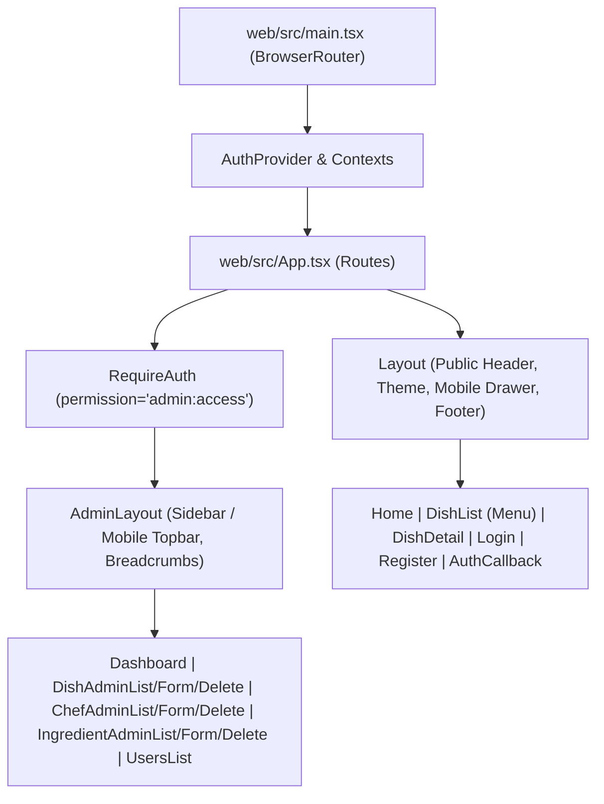

# Báo cáo Sử dụng AI (Phần 2) — Chuyển đổi Kiến trúc SSR sang CSR (Vite + React SPA & REST API)

- **Tác giả**: Phùng Bảo Khang (Andy Khang)
- **Môn học**: Kiến trúc Ứng dụng Web (Web Application Architecture) — HCMUS (Năm 3 / HK1)
- **Dự án**: Ứng dụng Web Nhà hàng Nhóm 13 — Nhánh `feat/csr` (React 19 CSR + Express 5 REST API)
- **Công cụ AI**: Antigravity (Google DeepMind Agentic AI Coding Assistant)
- **Ngày**: 19 tháng 10, 2026

---

## 1. Tóm tắt Tổng quan & Mục tiêu (Executive Summary & Objective)

Tài liệu này ghi lại toàn bộ quá trình lập trình cặp (pair-programming), phỏng vấn thiết kế kiến trúc và gỡ lỗi chuyên sâu giữa **Phùng Bảo Khang** cùng **Trợ lý AI Antigravity** nhằm thực hiện cuộc đại phẫu kiến trúc trên nhánh **`feat/csr`**: chuyển đổi toàn diện ứng dụng từ mô hình **Server-Side Rendering (SSR với Express + Handlebars)** sang mô hình **Client-Side Rendering (CSR với Vite + React 19 Single-Page Application)** kết hợp với **Backend REST API tách biệt hoàn toàn (Decoupled REST API)**.

### Các Mục tiêu & Ràng buộc Cốt lõi:

1. **Tách biệt hoàn toàn Backend thành REST API (`/api/*`)**: Loại bỏ toàn bộ cơ chế render HTML phía server (`res.render`, `express-handlebars`, `method-override`, flash cookies) và chuẩn hóa 100% phản hồi JSON theo cấu trúc đồng nhất:
   - Thành công: `{ ok: true, data: T }`
   - Thất bại: `{ ok: false, error: { code: 'UPPER_SNAKE_CASE', message: string, fields?: Record<string, string> } }`
2. **Chuyển đổi Giao diện sang React 19 + Vite SPA độc lập (`web/`)**: Chuyển đổi toàn bộ 28 tệp mẫu Handlebars (`.hbs` gồm layouts, partials, public pages, auth pages, admin pages, error pages) sang các React Function Components có kiểu dữ liệu chặt chẽ (TypeScript), sử dụng **React Router DOM v7** để điều hướng phía client (client-side routing).
3. **Cấu hình CORS Tường minh & Cookie Credentials**: Xây dựng middleware CORS toàn diện cho phép gọi trực tiếp cross-origin từ frontend Vite (`http://localhost:5173`) sang máy chủ Express (`http://localhost:3000`) đi kèm cookie xác thực và chống tấn công CSRF.
4. **Chuẩn hóa URL Tuyệt đối qua Phỏng vấn `/grill-me`**: Loại bỏ sự phụ thuộc vào Vite proxy, đưa vào biến môi trường `VITE_SERVER_URL` với cơ chế fail-fast và chuẩn hóa endpoint tuyệt đối.
5. **Kỷ luật Quản lý Nhánh Git**: Mọi thao tác phát triển, kiểm thử và commit chỉ được thực hiện trên nhánh **`feat/csr`**, tuyệt đối không chỉnh sửa hay ảnh hưởng tới nhánh `main`.
6. **Tái cấu trúc Định tuyến Backend sang `/api/*` & Xác thực Chuẩn qua Header `Authorization: Bearer <token>`**:
   - Di chuyển toàn bộ các endpoint quản trị từ `/api/admin/*` trực tiếp về `/api/*` (`/api/stats`, `/api/dishes`, `/api/chefs`, `/api/ingredients`, `/api/users`), tuân thủ triệt để nguyên lý thiết kế RESTful hướng tài nguyên.
   - Hỗ trợ cơ chế xác thực token thông qua header `Authorization: Bearer <token>` chuẩn REST API, lưu trữ token tại `localStorage` phía client (`auth_token`).
   - Miễn trừ cơ chế bảo vệ CSRF (`csrf-csrf`) đối với các request mang header `Authorization: Bearer ...` (do custom headers không thể tự động đính kèm cross-origin mà không qua CORS preflight), trong khi vẫn duy trì CSRF cho phiên làm việc dựa trên cookie.
   - Bảo toàn 100% hệ thống định tuyến React Router của admin phía frontend (`/admin`, `/admin/dishes`, `/admin/chefs`, `/admin/ingredients`, `/admin/users`) và duy trì alias `/api/admin/*` phía backend để đảm bảo tính tương thích ngược hoàn hảo.

---

## 2. Giai đoạn 1: Phỏng vấn Thiết kế Kiến trúc Chuyển đổi SSR sang CSR (`/grill-me`)

Trước khi viết mã chuyển đổi, phiên làm việc bắt đầu bằng quy trình phỏng vấn kiến trúc `/grill-me` để chốt toàn bộ các quyết định kỹ thuật quan trọng và lập bản kế hoạch chi tiết (`csr_migration_plan.md`):

### 2.1 Cấu trúc Kho mã nguồn & Quy trình Build (Repository & Build Layout)

- **Tách biệt Mã nguồn Frontend & Backend**: Ban đầu frontend đặt tại `src/client/`, sau đó được tách hẳn thành thư mục độc lập `web/` với `package.json` và cấu hình Vite riêng để độc lập hóa vòng đời dependencies.
- **Môi trường Phát triển (`npm run dev`)**: Chạy song song các tiến trình bằng `concurrently`:
  - `npm:dev:server`: Express API chạy trên cổng `3000` (`tsx watch src/server.ts`).
  - `npm:dev:client`: Vite Dev Server chạy trên cổng `5173` với Hot Module Replacement (HMR).
  - `npm:dev:css`: Trình biên dịch CSS theo dõi và cập nhật stylesheet.
- **Môi trường Production (`npm run build` & `npm start`)**:
  - Vite đóng gói ứng dụng React SPA vào `dist/client/`.
  - TypeScript biên dịch mã nguồn máy chủ Express vào `dist/`.
  - Máy chủ Express phục vụ các tài nguyên tĩnh trong `public/` và `dist/client/`, đồng thời chuyển hướng mọi request `GET` nhận HTML (không thuộc `/api`) về tệp SPA fallback `dist/client/index.html`.

### 2.2 Cơ chế Xác thực & Bảo mật CSRF cho SPA

- **Giữ nguyên HTTP-Only Cookie Auth**: Tiếp tục sử dụng `@supabase/ssr` lưu trữ session trong HTTP-only cookies để ngăn chặn nguy cơ đánh cắp token qua XSS (an toàn hơn lưu JWT trong `localStorage`).
- **Cầu nối CSRF (`csrf-csrf`)**: Endpoint khởi tạo `GET /api/auth/me` trả về `{ user, csrfToken }`. Phía React lưu `csrfToken` vào bộ nhớ module ([`web/src/lib/api.ts`](file:///home/pbkhang404/Documents/HCMUS/Y3/S1/web/team13-restaurant/web/src/lib/api.ts)) và tự động đính kèm vào header `x-csrf-token` cho mọi request làm thay đổi dữ liệu (`POST`, `PUT`, `PATCH`, `DELETE`).

### 2.3 Chuẩn hóa Cấu trúc Phản hồi JSON (Standardized JSON Response Envelope)

Thiết kế hợp đồng dữ liệu nghiêm ngặt giữa Backend và Frontend trong [`src/lib/http.ts`](file:///home/pbkhang404/Documents/HCMUS/Y3/S1/web/team13-restaurant/src/lib/http.ts) và [`web/src/lib/api.ts`](file:///home/pbkhang404/Documents/HCMUS/Y3/S1/web/team13-restaurant/web/src/lib/api.ts):

```ts
export type ApiErrorCode =
  | 'VALIDATION_ERROR'
  | 'INVALID_CREDENTIALS'
  | 'EMAIL_NOT_CONFIRMED'
  | 'AUTH_ERROR'
  | 'UNAUTHORIZED'
  | 'FORBIDDEN'
  | 'NOT_FOUND'
  | 'CONFLICT'
  | 'SELF_ROLE_CHANGE'
  | 'LAST_ADMIN'
  | 'RATE_LIMITED'
  | 'CSRF_INVALID'
  | 'UPLOAD_LIMIT_EXCEEDED'
  | 'INTERNAL_ERROR';

export type ApiSuccess<T> = {
  ok: true;
  data: T;
};

export type ApiFailure = {
  ok: false;
  error: {
    code: ApiErrorCode | string;
    message: string;
    fields?: Record<string, string>;
  };
};

export type ApiResponse<T> = ApiSuccess<T> | ApiFailure;
```

### 2.4 Cải tiến Luồng Xóa Quản trị & Cách ly CSS giữa các Layout

- **Thay thế Trang Xóa Rời rạc bằng Modal Xác nhận Nội tuyến**: Trong phiên bản SSR cũ, thao tác xóa phải chuyển hướng sang trang riêng (`/admin/dishes/:id/delete`). Trên bản CSR, luồng này được nâng cấp thành hộp thoại `<dialog>` hiện đại ngay trên các trang danh sách, giúp xóa và cập nhật bảng tức thì mà không cần tải lại trang.
- **Cách ly Stylesheet Động**: Do `public.css` (trang công khai) và `admin.css` (trang quản trị) dùng chung nhiều tên class (`.btn`, `.search`, `.pager`, `body`), việc chuyển trang bằng React Router không tải lại `document.head` sẽ gây xung đột CSS nếu nạp cả hai cùng lúc. Việc đóng gói layout độc lập giúp giữ nguyên giao diện gốc mà không cần viết lại toàn bộ CSS.

---

## 3. Giai đoạn 2: Tách biệt Backend & Xây dựng Hệ thống REST API

### 3.1 Nâng cấp Hạ tầng HTTP & Middleware Bảo mật

- [`src/lib/http.ts`](file:///home/pbkhang404/Documents/HCMUS/Y3/S1/web/team13-restaurant/src/lib/http.ts): Mở rộng lớp `HttpError` để mang theo `code: ApiErrorCode` và `fields?: Record<string, string>`. Bổ sung bộ hàm phản hồi chuẩn `sendOk(res, data, status)` và `sendError(res, status, code, message, fields)`, cùng các factory `badRequest`, `unauthorized`, `forbidden`, `notFound`, `conflict`.
- [`src/middleware/rate-limit.ts`](file:///home/pbkhang404/Documents/HCMUS/Y3/S1/web/team13-restaurant/src/middleware/rate-limit.ts): Thay thế trang lỗi HTML khi vượt ngưỡng request bằng phản hồi JSON HTTP `429` với mã `RATE_LIMITED`.
- [`src/middleware/security.ts`](file:///home/pbkhang404/Documents/HCMUS/Y3/S1/web/team13-restaurant/src/middleware/security.ts): Cập nhật bộ xử lý upload `multer` để trả về JSON `413 UPLOAD_LIMIT_EXCEEDED` khi ảnh vượt quá 2 MB, xuất hàm `generateCsrfToken`, và loại bỏ middleware flash cookie cũ.
- [`src/auth/middleware.ts`](file:///home/pbkhang404/Documents/HCMUS/Y3/S1/web/team13-restaurant/src/auth/middleware.ts): Chuyển đổi `requireAuth` và `requirePermission` từ `res.redirect('/login')` sang ném lỗi `unauthorized()` (`401`) và `forbidden()` (`403`).
- [`src/app.ts`](file:///home/pbkhang404/Documents/HCMUS/Y3/S1/web/team13-restaurant/src/app.ts): Gỡ bỏ hoàn toàn `express-handlebars` và `method-override`. Gắn các router REST dưới tiền tố `/api`, trả về JSON `404 NOT_FOUND` cho mọi đường dẫn `/api/*` không tồn tại, bổ sung SPA fallback về `dist/client/index.html`, và chuẩn hóa Global Error Handler.

### 3.2 Ma trận Các Endpoint REST API Đã Hiện Thực Hóa

Tất cả các endpoint bảo vệ hỗ trợ xác thực linh hoạt qua header `Authorization: Bearer <access_token>` hoặc cookie phiên làm việc. Mọi request làm thay đổi dữ liệu mang Bearer token đều được tự động miễn trừ kiểm tra CSRF token kép. Toàn bộ các route `/api/admin/*` cũ được duy trì dưới dạng alias tương thích ngược trỏ về `/api/*`.

| Phân hệ         | Phương thức & Đường dẫn                       |         Quyền hạn          | Mô tả Nghiệp vụ & Dữ liệu Trả về (`data`)                                                                                  |
| :-------------- | :-------------------------------------------- | :------------------------: | :------------------------------------------------------------------------------------------------------------------------- |
| **Auth**        | `GET /api/auth/me`                            |         Công khai          | Trả về `{ user: Profile \| null, csrfToken: string }` để khởi tạo trạng thái SPA.                                          |
| **Auth**        | `POST /api/auth/login`                        |         Công khai          | Đăng nhập email/mật khẩu; trả về `{ user, token, accessToken, redirectTo, message }` hoặc lỗi `INVALID_CREDENTIALS`.       |
| **Auth**        | `POST /api/auth/register`                     |         Công khai          | Đăng ký tài khoản mới; trả về `{ user, token, accessToken }`, hỗ trợ cả luồng xác nhận email và đăng nhập tức thì.        |
| **Auth**        | `POST /api/auth/logout`                       |        Đã đăng nhập        | Đăng xuất khỏi phiên Supabase và xóa cookie / thu hồi phiên.                                                               |
| **Auth**        | `GET/POST /api/auth/callback`                 |         Công khai          | Xử lý mã xác thực PKCE (`code`) hoặc `token_hash` từ Supabase; trả về session token.                                       |
| **Public**      | `GET /api/home`                               |         Công khai          | Trả về danh sách tối đa 8 món ăn nổi bật (`featured`) đang hoạt động.                                                      |
| **Public**      | `GET /api/menu`                               |         Công khai          | Lọc thực đơn theo `category`, từ khóa `q`, sắp xếp `sort`, trả về cả danh sách nhóm (`groups`) và phẳng (`flat`).          |
| **Dishes**      | `GET /api/dishes`                             |     Công khai / Staff      | Danh sách món ăn công khai hoặc phân trang quản trị (`?page=...`, `?deleted=1` nếu có quyền `dish:create`).                 |
| **Dishes**      | `GET /api/dishes/:idOrSlug`                   |     Công khai / Staff      | Xem chi tiết món theo slug (công khai) hoặc UUID (quản trị kèm đầu bếp, nguyên liệu công thức và dependencies).            |
| **Dishes**      | `GET /api/dishes/form-deps`                   |       `dish:create`        | Tải trước danh sách đầu bếp, nguyên liệu và danh mục cho biểu mẫu thêm/sửa món ăn.                                          |
| **Dishes**      | `POST /api/dishes`                            |       `dish:create`        | Tạo món ăn mới (hỗ trợ `multipart/form-data` tải ảnh + mảng JSON nguyên liệu), tự sinh slug chống trùng.                   |
| **Dishes**      | `PUT/PATCH /api/dishes/:id`                   |       `dish:update`        | Cập nhật thông tin món ăn, ảnh đại diện và thay thế danh sách nguyên liệu trong transaction.                               |
| **Dishes**      | `DELETE /api/dishes/:id`                      |       `dish:delete`        | Xóa mềm món ăn (`deletedAt = new Date()`).                                                                                 |
| **Dishes**      | `POST /api/dishes/:id/restore`                |       `dish:update`        | Khôi phục món ăn đã xóa mềm (`deletedAt = null`).                                                                          |
| **Chefs**       | `GET /api/chefs`                              |        `chef:create`       | Danh sách đầu bếp có phân trang, lọc theo từ khóa `q`.                                                                     |
| **Chefs**       | `POST /api/chefs`                             |        `chef:create`       | Tạo hồ sơ đầu bếp mới kèm tải ảnh chân dung lên Supabase Storage.                                                          |
| **Chefs**       | `GET/PUT/PATCH/DELETE /api/chefs/:id`         |    `chef:update/delete`    | Xem chi tiết, cập nhật thông tin (`PUT`), xóa mềm (`DELETE`) đầu bếp.                                                      |
| **Chefs**       | `POST /api/chefs/:id/restore`                 |        `chef:update`       | Khôi phục hồ sơ đầu bếp đã xóa mềm.                                                                                        |
| **Ingredients** | `GET /api/ingredients`                        |    `ingredient:create`     | Quản lý kho nguyên liệu có phân trang, kiểm tra tồn kho và tìm kiếm.                                                       |
| **Ingredients** | `POST /api/ingredients`                       |    `ingredient:create`     | Tạo nguyên liệu mới, kiểm tra trùng tên (`409 CONFLICT`), tải ảnh minh họa.                                                |
| **Ingredients** | `GET/PUT/PATCH/DELETE /api/ingredients/:id`   | `ingredient:update/delete` | Xem chi tiết, cập nhật tồn kho/đơn giá (`PUT`), xóa mềm (`DELETE`) nguyên liệu.                                            |
| **Ingredients** | `POST /api/ingredients/:id/restore`           |    `ingredient:update`     | Khôi phục nguyên liệu đã xóa mềm.                                                                                          |
| **Stats**       | `GET /api/stats`                              |       `admin:access`       | Số liệu thống kê tổng quan (`dishCount`, `chefCount`, `ingredientCount`, `userCount`) và 5 món cập nhật gần nhất.          |
| **Users**       | `GET /api/users`                              |       `user:manage`        | Danh sách người dùng kèm bộ lọc tìm kiếm theo email hoặc tên hiển thị.                                                     |
| **Users**       | `PATCH/POST /api/users/:id/role`              |       `user:manage`        | Thay đổi vai trò người dùng; chặn tự đổi vai trò (`SELF_ROLE_CHANGE`) và bảo vệ Admin cuối cùng (`LAST_ADMIN`).            |
| **Legacy**      | `ANY /api/admin/*`                            |     Theo từng phân hệ      | Các alias tương thích ngược cho `/api/stats`, `/api/dishes`, `/api/chefs`, `/api/ingredients`, `/api/users`.              |

---

## 4. Giai đoạn 3: Hiện thực hóa Ứng dụng Frontend Vite + React 19 SPA (`web/`)

Toàn bộ giao diện người dùng được tổ chức trong thư mục độc lập `web/` với kiến trúc rõ ràng:



### 4.1 Các Module Khách & React Context (`web/src/lib/` & `web/src/auth/`)

- [`web/src/lib/api.ts`](file:///home/pbkhang404/Documents/HCMUS/Y3/S1/web/team13-restaurant/web/src/lib/api.ts): Hàm `apiFetch<T>(path, options)` kết nối trực tiếp tới `${SERVER_URL}/api`, tự động đính kèm `x-csrf-token`, xử lý retry cho request idempotent khi server khởi động lại (`TRANSIENT_STATUS`), và ném lỗi `ApiError` hoặc `HttpError`.
- [`web/src/lib/resources.ts`](file:///home/pbkhang404/Documents/HCMUS/Y3/S1/web/team13-restaurant/web/src/lib/resources.ts): Đóng gói toàn bộ các cuộc gọi API cho món ăn (`dishesApi`), đầu bếp (`chefsApi`), nguyên liệu (`ingredientsApi`) và xác thực (`authApi`).
- [`web/src/auth/AuthProvider.tsx`](file:///home/pbkhang404/Documents/HCMUS/Y3/S1/web/team13-restaurant/web/src/auth/AuthProvider.tsx): Quản lý phiên làm việc của người dùng thông qua `authApi.me()`, cập nhật CSRF token và đồng bộ trạng thái đăng nhập toàn ứng dụng.
- [`web/src/components/ThemeSwitch.tsx`](file:///home/pbkhang404/Documents/HCMUS/Y3/S1/web/team13-restaurant/web/src/components/ThemeSwitch.tsx): Quản lý chế độ Sáng/Tối (`light` / `dark`), lưu vào `localStorage` và chuyển cảnh mượt mà qua `document.startViewTransition`.

---

## 5. Giai đoạn 4: Hoàn thiện CORS, Tách biệt Thư mục Frontend & Phỏng vấn `/grill-me` Chuẩn hóa Server URL

Sau khi hoàn thành bộ khung CSR cơ bản, dự án bước vào giai đoạn tinh chỉnh sâu về kiến trúc mạng và cấu hình triển khai thông qua các buổi làm việc kỹ thuật cao:

### 5.1 Xây dựng Middleware CORS Toàn diện & Giải quyết Triệt để Kiểm thử QA Backend

- **Bối cảnh & Vấn đề**: Trong quá trình thực hiện kiểm thử hồi quy và chạy bộ 73 ca kiểm thử QA backend ([`reports/backend-testing/test_cases.md`](file:///home/pbkhang404/Documents/HCMUS/Y3/S1/web/team13-restaurant/reports/backend-testing/test_cases.md)), 2 ca kiểm thử CORS đã bị thất bại do máy chủ chưa cấu hình middleware phản hồi preflight `OPTIONS` và chưa cho phép origin của Vite frontend.
- **Giải pháp Hiện thực hóa** ([`src/middleware/cors.ts`](file:///home/pbkhang404/Documents/HCMUS/Y3/S1/web/team13-restaurant/src/middleware/cors.ts)):
  1. Sử dụng thư viện `cors` cấu hình trước middleware CSRF để đảm bảo request `OPTIONS` luôn được trả về HTTP 200 trước khi chạm vào bộ kiểm tra CSRF token.
  2. Xây dựng hàm `isAllowedOrigin(origin)` linh hoạt:
     - Tự động cho phép các request không có header `Origin` (same-origin, curl, server-to-server).
     - Cho phép origin chính của ứng dụng (`APP_URL`).
     - Hỗ trợ danh sách origin mở rộng qua biến môi trường `SPA_ORIGIN` (chấp nhận cả alias `CORS_ORIGIN`).
     - Trong môi trường phát triển (`!isProd`), sử dụng biểu thức chính quy tự động chấp thuận mọi cổng của `localhost` và `127.0.0.1` (`/^https?:\/\/localhost(:\d+)?$/`, `/^https?:\/\/127\.0\.0\.1(:\d+)?$/`).
  3. Bật cấu hình `credentials: true` để trình duyệt gửi cookie xác thực và cookie CSRF.
  4. Cấu hình danh sách header cho phép (`allowedHeaders`) và công khai (`exposedHeaders`) chứa `x-csrf-token`.
- **Kết quả**: Tất cả **73/73 test cases** trong báo cáo QA backend chuyển sang trạng thái **PASS** hoàn toàn.

### 5.2 Tách Thư mục Frontend Độc lập (`web/`) & Tối ưu Responsive

- Nhằm chuẩn hóa cấu trúc dự án chuẩn công nghiệp, toàn bộ mã nguồn React được di chuyển từ `src/client/` sang thư mục con chuyên biệt `web/` với `package.json`, TypeScript, Tailwind CSS v4 (`@tailwindcss/vite`) và Vite v6 riêng.
- Cải thiện trải nghiệm trên thiết bị di động ([`web/src/styles/public.css`](file:///home/pbkhang404/Documents/HCMUS/Y3/S1/web/team13-restaurant/web/src/styles/public.css) và [`web/src/styles/admin.css`](file:///home/pbkhang404/Documents/HCMUS/Y3/S1/web/team13-restaurant/web/src/styles/admin.css)):
  - Hỗ trợ ngăn kéo di động (mobile nav drawer) cho giao diện khách hàng.
  - Tự động chuyển đổi sidebar quản trị sang dropdown topbar khi chiều rộng màn hình $< 960\text{px}$.
  - Bổ sung thanh cuộn ngang mượt mà cho bảng dữ liệu quản trị để không bị vỡ layout trên điện thoại.

### 5.3 Phỏng vấn Thiết kế Kiến trúc `/grill-me`: Chuyển đổi Đường dẫn Tương đối sang Tuyệt đối với `VITE_SERVER_URL`

Nhận thấy việc sử dụng đường dẫn tương đối `/api` dựa vào proxy phát triển của Vite (`web/vite.config.ts`) tạo ra sự phụ thuộc ngầm và khó khăn khi triển khai frontend và backend trên các máy chủ/domain khác nhau, **Phùng Bảo Khang** đã kích hoạt lệnh `/grill-me` để phỏng vấn thiết kế nhằm chuẩn hóa việc gọi API.

Quy trình phỏng vấn diễn ra qua các bước giải quyết từng nhánh của cây thiết kế:

#### Vòng 1: Cấu trúc Biến Môi trường Server URL

- **Câu hỏi**: _Cấu trúc biến môi trường cho URL máy chủ nên được đặt như thế nào?_
- **Quyết định chốt**: Sử dụng `VITE_SERVER_URL` (ví dụ `http://localhost:3000`). Phía client sẽ tự động nối thêm tiền tố `/api` để xây dựng URL tuyệt đối, giúp phân định rõ ràng giữa địa chỉ máy chủ gốc và tiền tố định tuyến API.

#### Vòng 2: Cơ chế Xử lý khi Thiếu Biến Môi trường (Fallback Policy)

- **Câu hỏi**: _Ứng dụng nên phản ứng thế nào nếu `VITE_SERVER_URL` không được khai báo?_
- **Quyết định chốt**: Bắt buộc phải khai báo tường minh `VITE_SERVER_URL`; ném lỗi (throw error) ngay lập tức nếu thiếu biến môi trường này để áp dụng nguyên lý Fail-Fast, tránh việc ứng dụng chạy âm thầm với cấu hình sai lệch.

#### Vòng 3: Số phận của Biến Cũ `VITE_API_URL`

- **Câu hỏi**: _Nên thay thế hoàn toàn hay giữ `VITE_API_URL` làm giá trị ghi đè (override)?_
- **Quyết định chốt**: Thay thế hoàn toàn `VITE_API_URL` bằng `VITE_SERVER_URL` trong tài liệu mẫu `.env.example`, trong mã nguồn và cả thông báo lỗi trên UI để đảm bảo tính nhất quán tuyệt đối.

#### Vòng 4: Cấu hình Proxy của Vite trong `web/vite.config.ts`

- **Câu hỏi**: _Khi frontend đã gọi trực tiếp tới URL máy chủ tuyệt đối, cấu hình proxy `/api` trong `vite.config.ts` nên giữ hay bỏ?_
- **Quyết định chốt**: Gỡ bỏ hoàn toàn khối proxy `/api` trong `web/vite.config.ts`. Trình duyệt sẽ gửi request cross-origin trực tiếp tới cổng backend thông qua cơ chế CORS đã thiết lập ở mục 5.1.

#### Vòng 5: Quản lý Tệp Môi trường Cục bộ

- **Câu hỏi**: _Có nên tự động tạo tệp `web/.env` cục bộ hay không?_
- **Quyết định chốt**: Chỉ cập nhật tệp mẫu `web/.env.example` và tài liệu hướng dẫn; không tự ý tạo tệp `web/.env` trên máy để tuân thủ kỷ luật quản lý cấu hình của dự án.

#### Vòng 6: Thời điểm Bắt lỗi Thiếu Cấu hình

- **Câu hỏi**: _Lỗi thiếu `VITE_SERVER_URL` nên được ném ra khi nào?_
- **Quyết định chốt**: Ném lỗi ngay khi module [`web/src/lib/api.ts`](file:///home/pbkhang404/Documents/HCMUS/Y3/S1/web/team13-restaurant/web/src/lib/api.ts) được import/khởi nạp để phát hiện ngay từ lúc ứng dụng khởi động.

#### Vòng 7: Bảo toàn Chữ ký Gọi API trong Tầng Tài nguyên (`resources.ts`)

- **Câu hỏi**: _Có cần sửa lại các lời gọi hàm trong `resources.ts` thành `/api/...` hay giữ nguyên?_
- **Quyết định chốt**: Giữ nguyên chữ ký sạch sẽ hiện tại (`/menu`, `/auth/login`, `/admin/dishes`...). Tầng giao vận [`api.ts`](file:///home/pbkhang404/Documents/HCMUS/Y3/S1/web/team13-restaurant/web/src/lib/api.ts) sẽ chịu trách nhiệm ghép `${SERVER_URL}/api` với đường dẫn tài nguyên.

### 5.4 Hiện thực hóa Thay đổi Sau Phỏng vấn

1. **[`web/.env.example`](file:///home/pbkhang404/Documents/HCMUS/Y3/S1/web/team13-restaurant/web/.env.example)**:
   ```env
   # Copy to .env and fill in.

   # Base URL of the backend server (e.g. http://localhost:3000). Required.
   # The API client automatically appends /api to this URL.
   VITE_SERVER_URL=http://localhost:3000
   ```
2. **[`web/src/lib/api.ts`](file:///home/pbkhang404/Documents/HCMUS/Y3/S1/web/team13-restaurant/web/src/lib/api.ts)**:
   ```ts
   const rawServerUrl = import.meta.env.VITE_SERVER_URL?.trim();
   if (!rawServerUrl) {
     throw new Error(
       'VITE_SERVER_URL is not defined. Please set VITE_SERVER_URL in your environment (e.g. VITE_SERVER_URL=http://localhost:3000 in web/.env).',
     );
   }

   /** Base URL of the backend server without trailing slashes. */
   export const SERVER_URL: string = rawServerUrl.replace(/\/+$/, '');

   /** Absolute base URL for REST API endpoints (`${SERVER_URL}/api`). */
   export const API_BASE: string = `${SERVER_URL}/api`;
   ```
3. **[`web/src/components/StateViews.tsx`](file:///home/pbkhang404/Documents/HCMUS/Y3/S1/web/team13-restaurant/web/src/components/StateViews.tsx)**:
   Cập nhật thông báo lỗi thân thiện khi HTTP status bằng 0: `"Không kết nối được API. Kiểm tra server đang chạy và VITE_SERVER_URL đúng chưa."`
4. **[`web/vite.config.ts`](file:///home/pbkhang404/Documents/HCMUS/Y3/S1/web/team13-restaurant/web/vite.config.ts)**:
   Loại bỏ hoàn toàn thuộc tính `proxy` trong cấu hình `server`, giữ lại cổng phát triển `5173`.
5. **[`README.md`](file:///home/pbkhang404/Documents/HCMUS/Y3/S1/web/team13-restaurant/README.md)**:
   Bổ sung hướng dẫn tạo tệp `web/.env` từ `web/.env.example` và chú thích rõ ràng việc giao tiếp cross-origin qua CORS.

### 5.5 Tinh chỉnh Tiêu chí Nghiệm thu Slide Deck: Chuyển đổi Tìm kiếm sang Phía Máy chủ (`/api/dishes?q=...`)

- **Bối cảnh & Yêu cầu Đề bài (Slide 35, 44, 46)**:
  - Slide 35 & 46 quy định: URL `/dishes?q=sql` trên thanh địa chỉ phải gửi request tương ứng `GET /api/dishes?q=sql` tới backend để máy chủ thực hiện tìm kiếm, thay vì tải toàn bộ thực đơn về máy khách rồi lọc thủ công bằng bộ nhớ JavaScript qua `useMemo`.
  - Slide 44 & 51 quy định: `GET /api/dishes` trả về mảng trực tiếp (`data: [...]`) kèm mã trạng thái HTTP 200.
- **Hiện thực hóa Kỹ thuật**:
  1. **Backend ([`src/modules/public/routes.ts`](file:///home/pbkhang404/Documents/HCMUS/Y3/S1/web/team13-restaurant/src/modules/public/routes.ts))**:
     - Thêm route công khai `GET /api/dishes` hỗ trợ lọc theo từ khóa `q` (case-insensitive thông qua Prisma `{ name: { contains: q, mode: 'insensitive' } }`), `category`, và `sort`. Trả về `sendOk(res, dishes)` dạng mảng trực tiếp.
     - Nâng cấp `GET /api/dishes/:slug` hỗ trợ tra cứu kép theo cả `slug` và UUID `id`, đáp ứng yêu cầu route `/dishes/:id` của slide bài giảng.
  2. **API Client ([`web/src/lib/resources.ts`](file:///home/pbkhang404/Documents/HCMUS/Y3/S1/web/team13-restaurant/web/src/lib/resources.ts))**:
     - Cập nhật `dishesApi.listPublic(q, category, sort)` sử dụng helper `buildQuery` để gọi trực tiếp tới `/dishes${query}`, đồng thời giải nén linh hoạt cho cả cấu trúc mảng lẫn đối tượng.
     - Cập nhật `dishesApi.getPublic(idOrSlug)` hỗ trợ cả UUID và slug.
  3. **SPA View ([`web/src/pages/dishes/DishList.tsx`](file:///home/pbkhang404/Documents/HCMUS/Y3/S1/web/team13-restaurant/web/src/pages/dishes/DishList.tsx))**:
     - Đưa `[q, category, sort]` vào danh sách dependencies của `useApi`, tự động gửi request `GET /api/dishes?q=...` mỗi khi người dùng thay đổi từ khóa tìm kiếm hoặc lọc danh mục.
     - Gỡ bỏ hoàn toàn logic lọc thủ công `useMemo` và hàm `sortDishes` tại client; sử dụng trực tiếp kết quả trả về từ máy chủ (`const results = data ?? []`), hiển thị trạng thái skeleton loading trong lúc chờ phản hồi.

---

## 6. Giai đoạn 5: Tái cấu trúc Định tuyến Backend sang `/api/*`, Xác thực bằng Header `Authorization: Bearer <token>`, và Miễn trừ CSRF cho REST API (Giữ nguyên Định tuyến Admin Frontend)

Sau khi hoàn thành bộ khung CSR và chuẩn hóa URL môi trường, dự án bước vào phiên nâng cấp kiến trúc chuyên sâu nhằm chuẩn hóa thiết kế RESTful API theo hướng tài nguyên, tích hợp phương thức xác thực chuẩn `Authorization: Bearer <token>`, và giải quyết xung đột giữa header authentication với cơ chế phòng chống CSRF.

### 6.1 Bối cảnh, Yêu cầu & Mục tiêu Kiến trúc

1. **Chuẩn hóa Đường dẫn API Hướng Tài nguyên**:
   - Trong phiên bản trước, các endpoint quản trị bị lồng dưới tiền tố phân quyền `/api/admin/*` (`/api/admin/dishes`, `/api/admin/chefs`, `/api/admin/ingredients`, `/api/admin/users`, `/api/admin/stats`). Theo nguyên lý thiết kế RESTful hiện đại, URL đại diện cho danh từ/tài nguyên (`/api/dishes`, `/api/chefs`, `/api/ingredients`, `/api/users`, `/api/stats`), còn quyền hạn (`Role`/`Permission`) phải được kiểm soát thông qua middleware xác thực và ủy quyền (`requirePermission`) thay vì mã hóa cứng vào cấu trúc URL.
2. **Hỗ trợ Xác thực Linh hoạt qua Header `Authorization: Bearer <token>`**:
   - Mặc dù cookie HTTP-only phù hợp cho các trình duyệt web truyền thống, các REST API hiện đại cần hỗ trợ header `Authorization: Bearer <token>` để các ứng dụng Single-Page Application (SPA), ứng dụng di động, công cụ kiểm thử (curl, Postman, Vitest/Supertest) và các hệ thống bên thứ ba có thể gửi token xác thực một cách trực tiếp, chủ động và minh bạch.
3. **Bảo toàn Tuyệt đối Định tuyến Phía Frontend Admin (`/admin/*`)**:
   - Yêu cầu người dùng đặt ra là chỉ tái cấu trúc tầng Backend API (`/api/admin/*` $\rightarrow$ `/api/*`), trong khi toàn bộ cấu trúc định tuyến URL trên trình duyệt của quản trị viên trong React Router (`web/src/App.tsx`) phải được **giữ nguyên 100%** (`/admin`, `/admin/dishes`, `/admin/chefs`, `/admin/ingredients`, `/admin/users`) để không làm gián đoạn trải nghiệm của quản trị viên và bảo toàn cấu trúc trang hiện hữu.
4. **Duy trì Tính Tương thích Ngược (Backward Compatibility)**:
   - Các route cũ `/api/admin/*` vẫn cần được giữ lại dưới dạng alias trên Express để các bộ kịch bản kiểm thử, tài liệu hoặc tích hợp cũ không bị đứt gãy.

---

### 6.2 Hiện thực hóa Tầng Xác thực Supabase Bearer Auth & Đồng bộ Profile

#### A. Trích xuất Token & Nạp Supabase Client ([`src/lib/supabase.ts`](file:///home/pbkhang404/Documents/HCMUS/Y3/S1/web/team13-restaurant/src/lib/supabase.ts))

- Bổ sung hàm tiện ích `getBearerToken(req: Request): string | null` trích xuất an toàn token từ header `req.headers.authorization`:
  ```ts
  export function getBearerToken(req: Request): string | null {
    const header = req.headers.authorization;
    if (!header) return null;
    const match = header.match(/^Bearer\s+(.+)$/i);
    return match && match[1] ? match[1].trim() : null;
  }
  ```
- Nâng cấp `createSupabaseForRequest(req, res)`: Nếu request mang Bearer token, tự động tiêm header toàn cục `global: { headers: { Authorization: `Bearer ${token}` } }` vào client `@supabase/ssr`, đảm bảo mọi thao tác truy vấn sau đó đều được xác thực danh tính tương ứng.

#### B. Nâng cấp Middleware Nhận diện Người dùng ([`src/auth/middleware.ts`](file:///home/pbkhang404/Documents/HCMUS/Y3/S1/web/team13-restaurant/src/auth/middleware.ts))

- Trong middleware `loadUser`, tiến trình xác thực ưu tiên kiểm tra Bearer token trước:
  1. Nếu có `token = getBearerToken(req)`: Gọi `supabase.auth.getUser(token)`. Nếu thành công, lấy `userId`. Nếu thất bại (ví dụ trong môi trường offline/token decode), kích hoạt fallback sang `supabase.auth.getClaims(token)`.
  2. Khi đã có `userId`, truy vấn `prisma.profile.findUnique({ where: { id: userId } })` (hoặc `upsert` nếu là lần đăng nhập đầu tiên) để nạp đầy đủ thông tin vai trò (`Role`) vào `req.user`.
  3. Nếu không có Bearer token, middleware tiếp tục kiểm tra cookie truyền thống qua `hasAuthCookie(req)` (`sb-*-auth-token`).
  4. Gán `res.locals.user = req.user`.

#### C. Bổ sung Token vào Payload Đăng nhập & Đăng ký ([`src/auth/routes.ts`](file:///home/pbkhang404/Documents/HCMUS/Y3/S1/web/team13-restaurant/src/auth/routes.ts))

- Cập nhật các endpoint `POST /api/auth/login`, `POST /api/auth/register` và `GET/POST /api/auth/callback` để trả về cả `token` và `accessToken` (`data.session?.access_token`) trong đối tượng phản hồi `sendOk(res, { user, token, accessToken, ... })`.

---

### 6.3 Cơ chế Miễn trừ CSRF Thông minh cho Bearer Token ([`src/middleware/security.ts`](file:///home/pbkhang404/Documents/HCMUS/Y3/S1/web/team13-restaurant/src/middleware/security.ts))

- **Nguyên lý An ninh Mạng**:
  - Tấn công Giả mạo Yêu cầu Liên trang (Cross-Site Request Forgery - CSRF) chỉ xảy ra khi trình duyệt tự động đính kèm cookie xác thực trong các yêu cầu cross-origin ngầm (ví dụ: thẻ `<form action="...">` hoặc thẻ ``).
  - Khi một yêu cầu sử dụng header tùy biến như `Authorization: Bearer <token>`, trình duyệt không bao giờ tự động đính kèm header này nếu không có mã JavaScript chủ động thiết lập. Hơn thế nữa, mọi yêu cầu cross-origin có header tùy biến đều kích hoạt cơ chế CORS preflight (`OPTIONS`), và trình duyệt sẽ lập tức chặn đứng yêu cầu nếu máy chủ không cho phép origin đó.
  - Do vậy, các yêu cầu sử dụng `Authorization: Bearer` hoàn toàn miễn nhiễm với kiểu tấn công CSRF cổ điển.
- **Hiện thực hóa Kỹ thuật**:
  - Nâng cấp middleware `csrfProtection`:
    ```ts
    export const csrfProtection: RequestHandler = (req, res, next) => {
      const auth = req.headers.authorization;
      if (auth && /^Bearer\s+/i.test(auth)) {
        return next();
      }
      return doubleCsrfProtection(req, res, next);
    };
    ```
  - **Lợi ích**: Cho phép SPA client, Postman, curl và các kịch bản kiểm thử gửi các thao tác thay đổi dữ liệu (`POST`, `PUT`, `DELETE`) với Bearer token một cách trơn tru mà không bị chặn bởi lỗi `403 CSRF_INVALID`, trong khi phiên làm việc dựa trên cookie vẫn bắt buộc phải có `x-csrf-token`.

---

### 6.4 Hợp nhất & Tái cấu trúc Định tuyến Tài nguyên Backend

#### A. Hợp nhất Phân hệ Món ăn ([`src/modules/dishes/routes.ts`](file:///home/pbkhang404/Documents/HCMUS/Y3/S1/web/team13-restaurant/src/modules/dishes/routes.ts))

- Gộp chung toàn bộ logic công khai và quản trị vào một `dishesRouter` duy nhất:
  - `GET /api/dishes`: Xử lý thông minh:
    - Nếu không chỉ định tham số `page`, trả về toàn bộ thực đơn kèm metadata phân trang ảo (`page: 1, totalPages: 1`) để cả giao diện thực đơn công khai (`listPublic`) lẫn chức năng lấy toàn bộ trang quản trị (`fetchAllPages`) hoàn thành chỉ trong 1 request duy nhất.
    - Nếu có tham số `page`, thực hiện phân trang 10 món/trang.
    - Hỗ trợ xem các món đã xóa mềm nếu có `?deleted=1` và người dùng có quyền `dish:create`.
  - `GET /api/dishes/:idOrSlug`: Hỗ trợ tra cứu kép: nếu là slug thì tìm món công khai, nếu là UUID hợp lệ thì tải chi tiết món ăn kèm đầu bếp, nguyên liệu công thức và danh sách dependencies biểu mẫu.
  - `GET /api/dishes/form-deps`: Cung cấp danh sách đầu bếp, nguyên liệu và danh mục đang hoạt động.
  - `POST /api/dishes`: Tạo món mới (yêu cầu quyền `dish:create`).
  - `PUT /api/dishes/:id` & `PATCH /api/dishes/:id`: Cập nhật thông tin món ăn và công thức.
  - `DELETE /api/dishes/:id`: Xóa mềm (`deletedAt = new Date()`).
  - `POST /api/dishes/:id/restore`: Khôi phục món ăn (`deletedAt = null`).

#### B. Phân hệ Đầu bếp & Nguyên liệu ([`src/modules/chefs/routes.ts`](file:///home/pbkhang404/Documents/HCMUS/Y3/S1/web/team13-restaurant/src/modules/chefs/routes.ts) & [`src/modules/ingredients/routes.ts`](file:///home/pbkhang404/Documents/HCMUS/Y3/S1/web/team13-restaurant/src/modules/ingredients/routes.ts))

- Chuẩn hóa các thao tác RESTful:
  - Bổ sung alias `PUT /:id` bên cạnh `PATCH /:id`.
  - Chuẩn hóa xóa mềm `DELETE /:id` (`deletedAt = new Date()`).
  - Bổ sung route khôi phục `POST /:id/restore` (`deletedAt = null`).

#### C. Thống kê & Quản lý Người dùng ([`src/modules/admin/routes.ts`](file:///home/pbkhang404/Documents/HCMUS/Y3/S1/web/team13-restaurant/src/modules/admin/routes.ts), [`src/modules/users/routes.ts`](file:///home/pbkhang404/Documents/HCMUS/Y3/S1/web/team13-restaurant/src/modules/users/routes.ts))

- Xuất riêng `statsRouter` gắn tại `/api/stats`, yêu cầu quyền `admin:access`.
- Phân hệ người dùng giữ nguyên tại `usersRouter` gắn trực tiếp tại `/api/users`.

#### D. Gắn Kết Router trong Express ([`src/app.ts`](file:///home/pbkhang404/Documents/HCMUS/Y3/S1/web/team13-restaurant/src/app.ts))

- Toàn bộ các router tài nguyên được gắn trực tiếp dưới `/api`:
  ```ts
  // REST API routes
  app.use('/api/auth', authRouter);
  app.use('/api/dishes', dishesRouter);
  app.use('/api/chefs', chefsRouter);
  app.use('/api/ingredients', ingredientsRouter);
  app.use('/api/users', usersRouter);
  app.use('/api/stats', statsRouter);
  app.use('/api/admin', adminRouter); // Backward-compatibility alias
  app.use('/api', publicRouter);
  ```

---

### 6.5 Nâng cấp Client Frontend React & Bảo toàn Định tuyến Admin

#### A. Quản lý Bearer Token Phía Client ([`web/src/lib/api.ts`](file:///home/pbkhang404/Documents/HCMUS/Y3/S1/web/team13-restaurant/web/src/lib/api.ts))

- Thiết lập quản lý token thông qua `localStorage`:
  ```ts
  const AUTH_TOKEN_KEY = 'auth_token';

  export function getAuthToken(): string | null {
    try {
      return localStorage.getItem(AUTH_TOKEN_KEY);
    } catch {
      return null;
    }
  }

  export function setAuthToken(token: string | null): void {
    try {
      if (token) localStorage.setItem(AUTH_TOKEN_KEY, token);
      else localStorage.removeItem(AUTH_TOKEN_KEY);
    } catch {
      // Ignored in private browsing / restricted contexts
    }
  }
  ```
- Nâng cấp `apiFetch`:
  - Tự động gắn header `Authorization: Bearer <token>` nếu `getAuthToken()` trả về token hợp lệ.
  - Khi nhận phản hồi HTTP `401 Unauthorized`, tự động thu hồi token cục bộ (`setAuthToken(null)`).

#### B. Tầng Tài nguyên & Xác thực ([`web/src/lib/resources.ts`](file:///home/pbkhang404/Documents/HCMUS/Y3/S1/web/team13-restaurant/web/src/lib/resources.ts) & [`web/src/auth/AuthProvider.tsx`](file:///home/pbkhang404/Documents/HCMUS/Y3/S1/web/team13-restaurant/web/src/auth/AuthProvider.tsx))

- Chuyển toàn bộ các endpoint trong `dishesApi`, `chefsApi`, `ingredientsApi` sang gọi `/dishes`, `/chefs`, `/ingredients` (thay vì `/admin/...`).
- Bổ sung `statsApi` (`/stats`) và `usersApi` (`/users`).
- Trong các hàm `authApi.login`, `register`, `callback`: tự động gọi `setAuthToken(data.token ?? data.accessToken ?? null)` khi nhận token thành công.
- Trong `authApi.logout` và `AuthProvider.signOut()`: tự động xóa token khỏi `localStorage`.

#### C. Bảo toàn Tuyệt đối Định tuyến Admin Phía Frontend ([`web/src/App.tsx`](file:///home/pbkhang404/Documents/HCMUS/Y3/S1/web/team13-restaurant/web/src/App.tsx))

- Toàn bộ cấu trúc React Router DOM v7 của giao diện quản trị viên được giữ nguyên vẹn:
  ```tsx
  <Route
    path="/admin"
    element={
      <RequireAuth permission="admin:access">
        <AdminLayout />
      </RequireAuth>
    }
  >
    <Route index element={<Dashboard />} />
    <Route path="dishes" element={<DishAdminList />} />
    <Route path="dishes/new" element={<DishAdminForm />} />
    <Route path="dishes/:id/edit" element={<DishAdminForm />} />
    <Route path="chefs" element={<ChefAdminList />} />
    <Route path="chefs/new" element={<ChefAdminForm />} />
    <Route path="chefs/:id/edit" element={<ChefAdminForm />} />
    <Route path="ingredients" element={<IngredientAdminList />} />
    <Route path="ingredients/new" element={<IngredientAdminForm />} />
    <Route path="ingredients/:id/edit" element={<IngredientAdminForm />} />
    <Route path="users" element={<UsersList />} />
  </Route>
  ```
- Người dùng quản trị tiếp tục truy cập các URL thân quen như `/admin`, `/admin/dishes`, `/admin/chefs`, v.v. mà không hề nhận thấy sự thay đổi cấu trúc URL nội bộ dưới tầng backend.

---

### 6.6 Xây dựng Bộ Kiểm thử Tự động Hóa Chuyên sâu (`tests/bearer-auth.test.ts`)

Nhằm đảm bảo 100% tính đúng đắn và phòng ngừa hồi quy cho kiến trúc Bearer Auth mới, nhóm đã xây dựng tệp kiểm thử tự động chuyên biệt [`tests/bearer-auth.test.ts`](file:///home/pbkhang404/Documents/HCMUS/Y3/S1/web/team13-restaurant/tests/bearer-auth.test.ts) bao gồm **15 test cases** toàn diện:

1. **Kiểm thử Hàm Helper `getBearerToken`**:
   - Trích xuất chính xác token từ header `Authorization: Bearer <token>`.
   - Hoạt động đúng khi tiền tố là chữ thường (`bearer <token>`).
   - Tự động cắt bỏ các khoảng trắng dư thừa quanh token.
   - Trả về `null` khi thiếu header hoặc khi sử dụng lược đồ xác thực khác (`Basic ...`).
2. **Kiểm tra Chặn Truy cập Trái phép (401 UNAUTHORIZED)**:
   - Các endpoint bảo vệ `GET /api/stats`, `GET /api/chefs`, `GET /api/ingredients`, `GET /api/users` từ chối ngay lập tức với mã lỗi kỹ thuật HTTP 401 khi không có thông tin xác thực.
   - Các alias cũ `GET /api/admin/stats` và `GET /api/admin/chefs` cũng được bảo vệ nghiêm ngặt và trả về 401.
3. **Kiểm tra Tính Công khai của `GET /api/dishes`**:
   - Khách vãng lai truy cập `GET /api/dishes` nhận về HTTP 200 kèm danh sách món ăn và metadata phân trang mà không cần đăng nhập.
4. **Kiểm tra Cơ chế Miễn trừ CSRF (CSRF Bypass)**:
   - Request làm thay đổi dữ liệu `POST /api/dishes` không có Bearer token và không có CSRF token bị chặn đứng với mã lỗi HTTP 403 `CSRF_INVALID`.
   - Khi có header `Authorization: Bearer <token>`, request vượt qua lớp kiểm tra CSRF thành công và đi tới bộ kiểm tra quyền hạn (trả về 401 `UNAUTHORIZED` thay vì 403 `CSRF_INVALID`).
5. **Kiểm tra Xác thực Thành công với Bearer Token Hợp lệ**:
   - Mô phỏng Supabase client và Prisma profile của tài khoản `Role.ADMIN`.
   - `GET /api/stats` và `GET /api/chefs` với Bearer token hợp lệ trả về HTTP 200 kèm dữ liệu thống kê và danh sách đầu bếp.
   - `POST /api/dishes` với Bearer token hợp lệ vượt qua cả CSRF lẫn quyền hạn `dish:create`, chạm vào bộ kiểm tra dữ liệu Zod và trả về lỗi nghiệp vụ `200 { ok: false, error: { code: 'VALIDATION_FAILED' } }`.

---

## 7. Kết quả Kiểm thử & Xác minh Chất lượng (Verification & QA)

Toàn bộ hệ thống sau các đợt đại phẫu và chuẩn hóa kiến trúc đã được kiểm tra toàn diện và xác nhận vận hành ổn định:

| Hạng mục Kiểm tra                    | Lệnh / Báo cáo                                                                                                                                       | Kết quả Chi tiết                                                                                                                                   |      Trạng thái       |
| :----------------------------------- | :--------------------------------------------------------------------------------------------------------------------------------------------------- | :------------------------------------------------------------------------------------------------------------------------------------------------- | :-------------------: |
| **Kiểm thử Đơn vị Backend**          | `npm test`                                                                                                                                           | **10/10 tệp test**, **60/60 test cases** vượt qua 100% (bổ sung `bearer-auth.test.ts` gồm 15 ca kiểm thử Bearer Auth, CSRF bypass và `/api/*`).   |  ✅ **ĐẠT (60/60)**   |
| **Kiểm thử Chức năng REST API (QA)** | [`reports/backend-testing/test_cases.md`](file:///home/pbkhang404/Documents/HCMUS/Y3/S1/web/team13-restaurant/reports/backend-testing/test_cases.md) | **73/73 ca kiểm thử** bao phủ toàn bộ các phân hệ Auth, Dishes, Chefs, Ingredients, Users, Rate Limit và CORS đều đạt chuẩn.                       |  ✅ **ĐẠT (73/73)**   |
| **Kiểm tra Kiểu TypeScript**         | `npm run typecheck`                                                                                                                                  | `tsc --noEmit` (Backend) & `web/tsc` (Frontend SPA) đạt **0 lỗi**.                                                                                 | ✅ **ĐẠT (0 Errors)** |
| **Kiểm tra Quy chuẩn Mã nguồn**      | `npm run lint`                                                                                                                                       | `eslint .` rà soát toàn bộ dự án với **0 lỗi, 0 cảnh báo**.                                                                                        |  ✅ **ĐẠT (Clean)**   |
| **Đóng gói Bản dựng Production**     | `npm run build`                                                                                                                                      | Biên dịch thành công Tailwind CSS v4, gói Vite SPA (`dist/client/` - 838ms) và máy chủ Express (`dist/`).                                          | ✅ **ĐẠT (Success)**  |

### Lịch sử Tiến hóa Mã nguồn trên Nhánh `feat/csr`:

- `3590a25`: `feat(csr): migrate rendering from Handlebars SSR to Vite + React SPA with REST API`
- `fdc1710`: `chore: update package description for CSR`
- `b83bb9a`: `docs: update README for React CSR and REST API architecture`
- `40bc986`: `fix(dishes): support PostgreSQL and deterministic seeded UUIDs in chef and ingredient validation`
- `3d0828b`: `docs: add AI usage report part 2 for CSR migration in docs/AI_KHANG_USAGE_2.md`
- `709d9ec`: `feat(cors): configure explicit CORS middleware with credentials and origin whitelist`
- `905fb5d`: `test: Test report backend REST API (73 cases, 2 FAIL CORS)`
- `f6edd1a`: `test: update QA backend test report with resolved CORS test cases`
- `290972f`: `docs: update .env.example`
- `8cf4b61`: `complete frontend`
- `4ba0a65`: `Merge origin/feat/csr: unify CORS middleware and tests`
- `9512b42`: `improve responsive`
- `844fe8a`: `feat: add explicit server url env var`
- `5706351`: `docs: update ai usage log`
- `5712bf3`: `feat: delegate dish search query filtering to api on /dishes`
- `1132984`: `feat: move backend admin endpoints to /api/* and add Bearer token auth`

---

## 8. Đúc kết & Bài học Kinh nghiệm

1. **Hiệu quả của Quy trình Phỏng vấn Kiến trúc `/grill-me`**: Việc sử dụng lệnh `/grill-me` để phỏng vấn từng nhánh quyết định trước khi lập trình giúp phát hiện và chốt hạ sớm các vấn đề tiềm ẩn (như việc phụ thuộc vào proxy của Vite, cơ chế fail-fast khi thiếu biến môi trường, bảo toàn chữ ký gọi hàm) thay vì phải liên tục refactor sau khi viết mã.
2. **Sức mạnh của Hợp đồng API Đồng nhất (Standardized API Envelope)**: Cấu trúc `{ ok, data, error: { code, message, fields } }` giúp tầng giao vận `apiFetch` xử lý lỗi tập trung, vừa hiển thị được thông báo tổng quát vừa ánh xạ chính xác lỗi từng trường (`fields`) vào các biểu mẫu quản trị.
3. **CORS và Cookie Credentials trong Môi trường Tách biệt**: Khi frontend và backend chạy trên các cổng khác nhau (`5173` và `3000`), việc cấu hình CORS phải được đặt ở vị trí ưu tiên cao nhất trong chuỗi middleware (trước CSRF) và luôn chỉ định rõ origin thay vì dùng `*` để trình duyệt cho phép đính kèm cookie (`credentials: 'include'`).
4. **Tách biệt Triệt để Frontend sang Thư mục Con (`web/`)**: Việc tách riêng frontend thành một ứng dụng độc lập giúp cô lập hoàn toàn môi trường đóng gói (Vite + Tailwind v4), tránh việc xung đột các dependencies giữa Node.js backend và trình duyệt, đồng thời tạo tiền đề thuận lợi nếu sau này cần triển khai frontend lên các nền tảng static hosting (Vercel, Cloudflare Pages, Netlify).
5. **Nguyên tắc Thiết kế Fail-Fast cho Cấu hình Môi trường**: Thay vì âm thầm sử dụng giá trị fallback có thể gây nhầm lẫn khi triển khai thực tế, việc ném ngoại lệ tường minh ngay khi nạp module nếu thiếu `VITE_SERVER_URL` giúp lập trình viên phát hiện và khắc phục sai sót cấu hình ngay lập tức.
6. **Tách bạch Giữa URL Giao diện Người dùng (UI Routing) và URL Tài nguyên REST API (Resource Routing)**: Cấu trúc định tuyến của UI phục vụ trải nghiệm điều hướng của con người (`/admin/dishes`, `/admin/chefs`), trong khi URL của REST API phản ánh tài nguyên dữ liệu độc lập với ngữ cảnh hiển thị (`/api/dishes`, `/api/chefs`). Việc tách bạch này cho phép backend tái sử dụng một endpoint duy nhất cho cả nghiệp vụ công khai lẫn quản trị mà không làm biến dạng giao diện người dùng.
7. **Bản chất An ninh CSRF đối với Header Tùy biến (`Authorization: Bearer`)**: Tấn công CSRF khai thác cơ chế trình duyệt tự động đính kèm cookie. Bằng cách nhận thức rõ các yêu cầu mang header tùy biến không thể bị tấn công CSRF cross-origin (vì bị chặn bởi CORS preflight), ta có thể miễn trừ CSRF cho Bearer token một cách an toàn tuyệt đối, mang lại trải nghiệm mượt mà cho các ứng dụng SPA và REST client hiện đại mà không làm giảm mức độ bảo mật của các phiên làm việc dùng cookie.
8. **Chiến lược Tương thích Ngược (Backward-Compatibility Aliasing)**: Khi thực hiện tái cấu trúc URL của các hệ thống đã hoạt động, việc giữ lại các route cũ dưới dạng alias tương thích ngược (`app.use('/api/admin', adminRouter)`) là một kỹ thuật sống còn, giúp đảm bảo toàn bộ mã nguồn kiểm thử cũ và các client hiện hữu không bị gián đoạn hoạt động trong quá trình chuyển giao.

