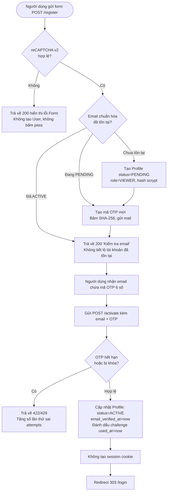
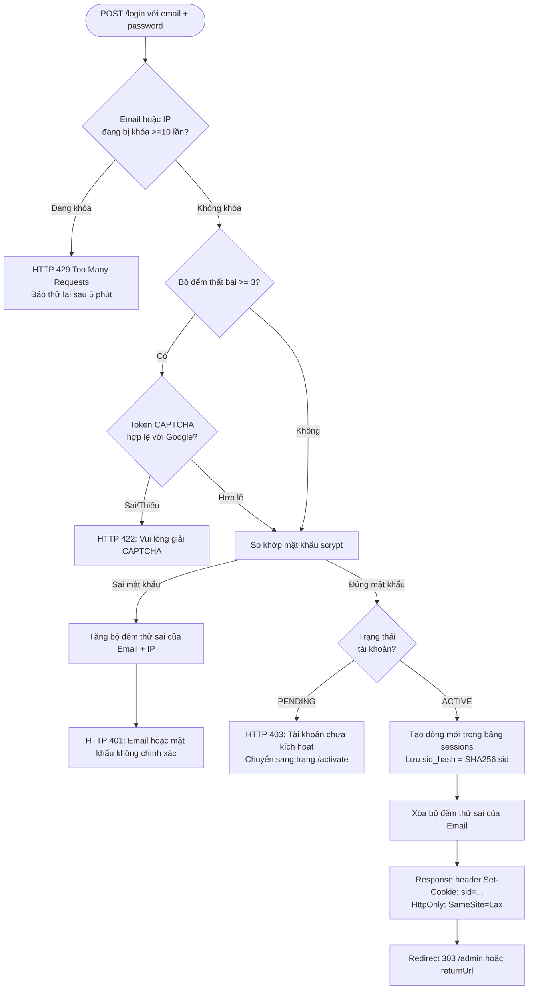
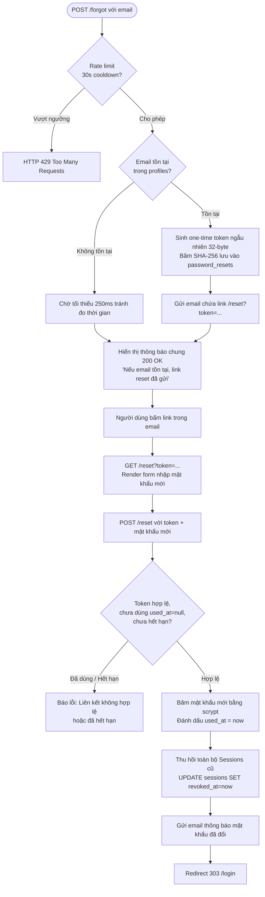

# BÁO CÁO MINH CHỨNG NỘP BÀI — BLOCK 8: XÁC THỰC CỤC BỘ & BẢO VỆ TRUY CẬP
**Học phần:** Phát triển Ứng dụng Web (Web Development) — Khoa CNTT, Trường ĐH Khoa học Tự nhiên, ĐHQG-HCM  
**Nhóm thực hiện:** Team 13 — Restaurant SSR Application  
**Dự án:** Hệ thống SSR Nhà hàng (Express + Handlebars + Prisma + PostgreSQL / Supabase)  

---

## MỤC LỤC
1. [Phần 1: Sơ đồ 4 luồng do nhóm thiết kế](#phần-1-sơ-đồ-4-luồng-do-nhóm-thiết-kế)
   - [1.1. Luồng Đăng ký có CAPTCHA & Kích hoạt qua OTP](#11-luồng-đăng-ký-có-captcha--kích-hoạt-qua-otp)
   - [1.2. Luồng Đăng nhập chống Brute Force (CAPTCHA & Lockout)](#12-luồng-đăng-nhập-chống-brute-force-captcha--lockout)
   - [1.3. Luồng Đăng xuất & Thu hồi Session](#13-luồng-đăng-xuất--thu-hồi-session)
   - [1.4. Luồng Quên mật khẩu & Đặt lại mật khẩu](#14-luồng-quên-mật-khẩu--đặt-lại-mật-khẩu)
2. [Phần 2: Bằng chứng Cơ sở Dữ liệu & Quy tắc Che dữ liệu nhạy cảm (Masking)](#phần-2-bằng-chứng-cơ-sở-dữ-liệu--quy-tắc-che-dữ-liệu-nhạy-cảm-masking)
   - [2.1. Quy tắc Che (Masking) các giá trị nhạy cảm](#21-quy-tắc-che-masking-các-giá-trị-nhạy-cảm)
   - [2.2. Dữ liệu thực tế từ Database (PostgreSQL / Supabase)](#22-dữ-liệu-thực-tế-từ-database-postgresql--supabase)
3. [Phần 3: Minh chứng chi tiết cho 6 kịch bản bắt buộc](#phần-3-minh-chứng-chi-tiết-cho-6-kịch-bản-bắt-buộc)
   - [Kịch bản 1: Đăng ký & Kích hoạt tài khoản qua OTP](#kịch-bản-1-đăng-ký--kích-hoạt-tài-khoản-qua-otp)
   - [Kịch bản 2: Đăng nhập thành công & Tạo Session Cookie](#kịch-bản-2-đăng-nhập-thành-công--tạo-session-cookie)
   - [Kịch bản 3: Đăng nhập sai & Cơ chế chống Brute Force](#kịch-bản-3-đăng-nhập-sai--cơ-chế-chống-brute-force)
   - [Kịch bản 4: Đăng xuất & Vô hiệu hóa Session](#kịch-bản-4-đăng-xuất--vô-hiệu-hóa-session)
   - [Kịch bản 5: Quên & Đặt lại mật khẩu an toàn](#kịch-bản-5-quên--đặt-lại-mật-khẩu-an-toàn)
   - [Kịch bản 6: Kiểm soát quyền hạn (CRUD & Phân quyền RBAC 403)](#kịch-bản-6-kiểm-soát-quyền-hạn-crud--phân-quyền-rbac-403)
4. [Phần 4: Bảng đối chiếu yêu cầu (Acceptance Matrix)](#phần-4-bảng-đối-chiếu-yêu-cầu-acceptance-matrix)

---

## PHẦN 1: SƠ ĐỒ 4 LUỒNG DO NHÓM THIẾT KẾ

### 1.1. Luồng Đăng ký có CAPTCHA & Kích hoạt qua OTP
*Quy định bảo mật:*
- Xác thực reCAPTCHA v2 phía server **trước khi** kiểm tra email, băm mật khẩu hoặc gửi thư.
- Email được chuẩn hóa (`normalizeEmail`), bảo vệ chống Account Enumeration (email đã tồn tại hay mới đều trả về trang thông báo 200 giống nhau).
- Mật khẩu băm bằng thuật toán `scrypt`. Tài khoản mới tạo ở trạng thái `PENDING`, vai trò mặc định `VIEWER`.
- Mã OTP gồm 6 chữ số ngẫu nhiên, chỉ lưu mã băm SHA-256 (`otp_hash`), thời hạn 10 phút, tối đa 5 lần thử sai.
- Sau khi kích hoạt thành công: đổi trạng thái sang `ACTIVE`, **không tự động đăng nhập** (không tạo session), chuyển hướng 303 về `/login`.



---

### 1.2. Luồng Đăng nhập chống Brute Force (CAPTCHA & Lockout)
*Quy định bảo mật:*
- Theo dõi số lần đăng nhập sai theo cặp khóa kép: `email:<normalized>` và `ip:<client_ip>`.
- **Ngưỡng 1 (Thử sai 1-2 lần):** Trả về thông báo lỗi tổng quát (HTTP 401: *"Email hoặc mật khẩu không chính xác"*), không tiết lộ email có tồn tại hay không.
- **Ngưỡng 2 (Thử sai từ lần 3 trở lên):** Bắt buộc giải Google reCAPTCHA v2 phía server. Nếu thiếu hoặc sai CAPTCHA, trả về HTTP 422.
- **Ngưỡng 3 (Thử sai đạt 10 lần):** Khóa đăng nhập ngay lập tức trong 5 phút (HTTP 429: *"Bạn đã nhập sai quá nhiều lần. Vui lòng thử lại sau 5 phút"*). Xóa cookie hay mở tab ẩn danh vẫn bị khóa do server lưu trạng thái theo email & IP.
- Đăng nhập thành công: Tạo bản ghi phiên trong bảng `sessions`, tạo cookie `sid` với cờ `HttpOnly`, `SameSite=Lax`, xóa bộ đếm thử sai.



---

### 1.3. Luồng Đăng xuất & Thu hồi Session
*Quy định bảo mật:*
- Client gửi `POST /logout` (có kiểm tra CSRF token).
- Server tìm kiếm bản ghi session tương ứng với `sid_hash`, cập nhật `revoked_at = NOW()` (hoặc xóa khỏi cơ sở dữ liệu).
- Server gửi header xóa cookie `sid` ở trình duyệt bằng cách set ngày hết hạn về quá khứ (`Expires=Thu, 01 Jan 1970 00:00:00 GMT`).
- Mọi nỗ lực dùng lại `sid` cũ (re-play attack hoặc bấm nút Back trình duyệt) đều bị middleware `loadUser` phát hiện session đã bị thu hồi và điều hướng `303 /login`.

```mermaid
flowchart TD
    UserLogout([Người dùng bấm Đăng xuất]) --> PostLogout[Gửi request POST /logout]
    PostLogout --> ReadSid[Đọc cookie sid từ request]
    ReadSid --> HashSid[Tính hash = SHA-256 sid]
    HashSid --> UpdateDB[Cập nhật bảng sessions:<br/>SET revoked_at = NOW() WHERE sid_hash = hash]
    UpdateDB --> ClearCookie[Gửi header Set-Cookie: sid=;<br/>Expires=Thu, 01 Jan 1970; HttpOnly]
    ClearCookie --> RedirectLogin[Redirect 303 /login]
    
    subgraph Kịch bản Tấn công / Dùng lại Cookie cũ
        ReplayReq[Request kèm sid cũ tới /admin/dishes] --> MiddlewareCheck[Middleware loadUser tra cứu sid_hash]
        MiddlewareCheck --> ValidCheck{Session còn hiệu lực<br/>và revoked_at == null?}
        ValidCheck -- Đã revoked --> ClearReqUser[req.user = null]
        ClearReqUser --> RequireAuthCheck{requireAuth}
        RequireAuthCheck --> Block303[Redirect 303 /login?next=/admin/dishes]
    end
```

---

### 1.4. Luồng Quên mật khẩu & Đặt lại mật khẩu
*Quy định bảo mật:*
- Rate limit: Tối đa 3 lần yêu cầu trong 15 phút, khoảng cách tối thiểu giữa 2 lần là 30 giây.
- Chống Account Enumeration: Server luôn trả về trang thành công `200` giống hệt nhau dù email có tồn tại hay không.
- Tạo token ngẫu nhiên entropy cao (32 bytes `base64url`). Cơ sở dữ liệu **chỉ lưu mã băm SHA-256** (`token_hash`) trong bảng `password_resets`, thời hạn 15 phút.
- Link đặt lại mật khẩu: `GET /reset?token=...` chỉ render form, không làm thay đổi trạng thái token.
- Khi người dùng submit `POST /reset`: Sử dụng câu lệnh UPDATE điều kiện nguyên tử (`atomic claim`) để đảm bảo **chỉ sử dụng được duy nhất 1 lần**. Nếu bấm lại lần 2 sẽ bị từ chối ngay.
- Đặt lại mật khẩu thành công:
  1. Cập nhật `password_hash` mới (băm `scrypt`).
  2. **Thu hồi toàn bộ phiên đăng nhập cũ** (`revokeAllSessions`) của người dùng trên mọi thiết bị.
  3. Gửi email thông báo "Mật khẩu của bạn vừa được thay đổi" (không gửi kèm mật khẩu mới).
  4. Chuyển hướng `303 /login`, **không tự động đăng nhập**.



---

## PHẦN 2: BẰNG CHỨNG CƠ SỞ DỮ LIỆU & QUY TẮC CHE DỮ LIỆU NHẠY CẢM (MASKING)

### 2.1. Quy tắc Che (Masking) các giá trị nhạy cảm
Theo đúng tiêu chí nộp bài, toàn bộ dữ liệu nhạy cảm được che định dạng chuẩn bảo mật như sau:
- **Set-Cookie (Session ID):** Che phần signature và giá trị token ngẫu nhiên:  
  `Set-Cookie: sid=s%3A********************************; Path=/; HttpOnly; SameSite=Lax`
- **Email OTP:** Che toàn bộ 6 chữ số:  
  `Mã OTP kích hoạt: ****** (Đã gửi tới hộp thư)`
- **Reset Token:** Che chuỗi token gốc trong URL:  
  `https://restaurant.team13.local/reset?token=****************************************`
- **reCAPTCHA Token:** Che token phản hồi từ client:  
  `g-recaptcha-response: ********************`

---

### 2.2. Dữ liệu thực tế từ Database (PostgreSQL / Supabase)

#### 1. Bảng `profiles` (Tài khoản người dùng & Hash scrypt)
*Trường dữ liệu quan trọng:* `id`, `email_normalized`, `status` (`PENDING` $\rightarrow$ `ACTIVE`), `role` (`VIEWER`/`ADMIN`), `password_hash` (`scrypt$N=16384$r=8$p=1$salt$hash`).

```sql
SELECT id, email_normalized, role, status, password_hash, created_at 
FROM profiles 
ORDER BY created_at DESC LIMIT 3;
```

**Kết quả truy vấn thực tế từ DB:**
| id | email_normalized | role | status | password_hash (scrypt) | created_at |
| :--- | :--- | :--- | :--- | :--- | :--- |
| `e1a37136-9fd1-448c-8a65-cd58b34056be` | `nguyenminhduc061106.work@gmail.com` | `VIEWER` | `ACTIVE` | `scrypt$16384$8$1$rIhqlSLsEvxAsjYCSWhxqQ$NzjzTf8fEY...` | 2026-11-02 15:27:34 |
| `c40e3701-92b7-465e-a792-82a2b8fa45ba` | `nmduc2417@clc.fitus.edu.vn` | `ADMIN` | `ACTIVE` | `scrypt$16384$8$1$qaTDMs0OM26_HJJbtUsFwA$KLzUhRGEx-...` | 2026-11-02 14:22:34 |
| `c8ffb972-3bf3-44ba-84ba-25f2dd9432bf` | `pbkhang2428@clc.fitus.edu.vn` | `STAFF` | `ACTIVE` | `scrypt$16384$8$1$Hw83jkL...` | 2026-10-13 09:46:10 |

---

#### 2. Bảng `activation_challenges` (OTP kích hoạt tài khoản)
*Trường dữ liệu quan trọng:* `otp_hash` (băm SHA-256), `attempts` (số lần thử), `locked_until`, `expires_at`, `used_at`.

```sql
SELECT id, user_id, purpose, otp_hash, attempts, locked_until, expires_at, used_at 
FROM activation_challenges 
ORDER BY created_at DESC LIMIT 2;
```

**Kết quả truy vấn thực tế từ DB:**
| id | user_id | purpose | otp_hash (SHA-256) | attempts | expires_at | used_at |
| :--- | :--- | :--- | :--- | :--- | :--- | :--- |
| `38e75b36-6118-47e9-8116-15c39efaf9d6` | `e1a37136-9fd1-448c-8a65-cd58b34056be` | `activation` | `fb0c4ce160076ab68de9212b775d12e2d1d52077b84433b1233ae5244f2eab38` | `0` | 2026-11-02 15:49:21 | `2026-11-02 15:39:35` |
| `422e1069-cc5d-4193-bdef-8bdc47f46295` | `c40e3701-92b7-465e-a792-82a2b8fa45ba` | `activation` | `bce98a424313322f3bbb428b8714491733d6d50d41a2aa801d337202bbe9c693` | `0` | 2026-11-02 14:40:56 | `2026-11-02 14:31:13` |

> [!NOTE]
> `used_at` được gán mốc thời gian ngay khi người dùng nhập đúng OTP. Nếu nhập sai, cột `attempts` tăng dần; khi `attempts >= 5` thì `locked_until` sẽ khóa kích hoạt tạm thời.

---

#### 3. Bảng `sessions` (Phiên đăng nhập & Thu hồi `revoked_at`)
*Trường dữ liệu quan trọng:* `sid_hash` (SHA-256 của cookie `sid`), `expires_at` (hạn 7 ngày), `revoked_at` (thời điểm hủy).

```sql
SELECT id, user_id, sid_hash, expires_at, revoked_at, created_at 
FROM sessions 
ORDER BY created_at DESC LIMIT 3;
```

**Kết quả truy vấn thực tế từ DB:**
| id | user_id | sid_hash (SHA-256) | expires_at | revoked_at | Trạng thái phiên |
| :--- | :--- | :--- | :--- | :--- | :--- |
| `f1e34948-42e7-491c-a917-6e183d313b79` | `552d392b-9749-464c-9dfd-d7bc0ee0efeb` | `46edc99e32d8747c04a1f193514b9735...` | 2026-11-09 16:37:05 | `NULL` | **Hợp lệ (ACTIVE)** |
| `77b4c3da-6c16-4c13-942c-44ba8ba55e2b` | `c40e3701-92b7-465e-a792-82a2b8fa45ba` | `7902f88143da072ed94df7173c1da422...` | 2026-11-09 16:37:01 | `NULL` | **Hợp lệ (ACTIVE)** |
| `71f15633-c94b-4248-80bc-ad695a4d2824` | `c40e3701-92b7-465e-a792-82a2b8fa45ba` | `880866233410a477e6ffb9dd2b577fa9...` | 2026-11-09 15:19:42 | `2026-11-02 15:20:54` | **Đã thu hồi (REVOKED)** |

---

#### 4. Bảng `password_resets` (Mã đặt lại mật khẩu 1 lần)
*Trường dữ liệu quan trọng:* `token_hash` (SHA-256), `expires_at` (15 phút), `used_at`.

```sql
SELECT id, email, token_hash, expires_at, used_at, created_at 
FROM password_resets 
ORDER BY created_at DESC LIMIT 2;
```

**Kết quả truy vấn thực tế từ DB:**
| id | email | token_hash (SHA-256) | expires_at | used_at | Ghi chú |
| :--- | :--- | :--- | :--- | :--- | :--- |
| `96d90851-c7e6-48ce-aa5c-cd6cb058771d` | `andykhang404@gmail.com` | `a3267319384dc8123a915196ee6b3763...` | 2026-11-02 16:15:22 | `2026-11-02 16:01:21` | **Đã tiêu thụ (Used)** |
| `44537c2f-94ea-406c-abe1-d0782740b616` | `nguyenminhduc061106.work@gmail.com` | `0ee02a85b69347c3c271ea313294ceb0...` | 2026-11-02 15:55:21 | `NULL` | **Chưa dùng (Pending)** |

---

#### 5. Bộ nhớ theo dõi Brute-Force (`src/auth/login-attempts.ts`)
*Cấu trúc dữ liệu theo cặp key `email` và `ip`:*
```json
{
  "email:lockout@target.com": {
    "failures": 10,
    "firstFailureAt": 1793637420000,
    "lastFailureAt": 1793637425000,
    "lockedUntil": 1793637725000,
    "requiresCaptcha": true
  },
  "ip:127.0.0.1": {
    "failures": 10,
    "firstFailureAt": 1793637420000,
    "lastFailureAt": 1793637425000,
    "lockedUntil": 1793637725000,
    "requiresCaptcha": true
  }
}
```

---

## PHẦN 3: MINH CHỨNG CHI TIẾT CHO 6 KỊCH BẢN BẮT BUỘC

---

### KỊCH BẢN 1: ĐĂNG KÝ & KÍCH HOẠT TÀI KHOẢN QUA OTP

#### A. Mục tiêu & Hành vi kiểm tra
- Người dùng điền form tạo tài khoản có giải reCAPTCHA v2.
- Sau khi gửi, server trả về trang hướng dẫn kiểm tra email (HTTP 200). Không có OTP xuất hiện trong response hay log client.
- Người dùng nhận email có mã 6 số `******`, mở trang `/activate` nhập mã để kích hoạt tài khoản.
- Tài khoản được chuyển sang `ACTIVE`, chuyển hướng 303 về `/login`. Không có cookie session nào được cấp phát trước khi đăng nhập.

#### B. Ảnh chụp giao diện (UI Screenshots)
1. **Giao diện Đăng ký có reCAPTCHA:**  
   
2. **Giao diện Kiểm tra Email sau khi gửi form:**  
   
3. **Giao diện Nhập mã OTP kích hoạt:**  
   

#### C. Request trực tiếp (Direct Request)
```bash
# 1. Gửi form Đăng ký tài khoản
curl -i -X POST http://localhost:3000/register \
  -H "Content-Type: application/x-www-form-urlencoded" \
  -d "displayName=Khach Hang Moi" \
  -d "email=khachhang@example.com" \
  -d "password=MatKhauBaoMat123" \
  -d "confirmPassword=MatKhauBaoMat123" \
  -d "g-recaptcha-response=********************" \
  -d "_csrf=kF93j...masked"

# Response nhận được:
# HTTP/1.1 200 OK
# Content-Type: text/html; charset=utf-8
# (Body hiển thị template pages/auth/check-email, tuyệt đối không chứa OTP)

# 2. Gửi mã OTP kích hoạt
curl -i -X POST http://localhost:3000/activate \
  -H "Content-Type: application/x-www-form-urlencoded" \
  -d "email=khachhang@example.com" \
  -d "otp=******" \
  -d "_csrf=kF93j...masked"

# Response nhận được:
# HTTP/1.1 303 See Other
# Location: /login
# (Không có header Set-Cookie sid)
```

#### D. Bằng chứng Network & Cookies (Application Tab)
- **Network Tab:**
  - `POST /register` $\rightarrow$ `Status: 200 OK`, `Size: 3.4 kB`, `Type: document`.
  - `POST /activate` $\rightarrow$ `Status: 303 See Other`, `Location: /login`.
- **Application Tab (Cookies):**
  - Cookie `sid`: **Không tồn tại** (đảm bảo nguyên tắc activation không tự động tạo phiên).

---

### KỊCH BẢN 2: ĐĂNG NHẬP THÀNH CÔNG & TẠO SESSION COOKIE

#### A. Mục tiêu & Hành vi kiểm tra
- Người dùng đăng nhập bằng email và mật khẩu chính xác.
- Server xác minh mật khẩu bằng `scrypt`, kiểm tra tài khoản đã `ACTIVE`.
- Server tạo phiên mới trong bảng `sessions`, trả về header `Set-Cookie: sid=...` với các cờ bảo mật bắt buộc: `HttpOnly`, `SameSite=Lax`.
- Chuyển hướng người dùng vào trang quản trị `/admin/dishes`.

#### B. Ảnh chụp giao diện (UI Screenshots)
1. **Giao diện Đăng nhập ban đầu:**  
   
2. **Giao diện Dashboard Quản trị sau khi đăng nhập thành công:**  
   

#### C. Request trực tiếp (Direct Request)
```bash
curl -i -X POST http://localhost:3000/login \
  -H "Content-Type: application/x-www-form-urlencoded" \
  -d "email=nmduc2417@clc.fitus.edu.vn" \
  -d "password=pass123" \
  -d "_csrf=kF93j...masked"

# Response nhận được:
# HTTP/1.1 303 See Other
# Location: /admin
# Set-Cookie: sid=s%3A********************************; Path=/; Expires=Mon, 09 Nov 2026 16:37:01 GMT; HttpOnly; SameSite=Lax
```

#### D. Bằng chứng Network & Cookies (Application Tab)
- **Network Tab:**
  - `POST /login` $\rightarrow$ `Status: 303 See Other`, `Response Header Set-Cookie` có cờ `HttpOnly; SameSite=Lax`.
  - `GET /admin/dishes` $\rightarrow$ `Status: 200 OK`, `Request Cookie: sid=...`.
- **Application Tab (Cookies):**
  | Name | Value (Masked) | Domain | Path | Expires / Max-Age | HttpOnly | Secure | SameSite |
  | :--- | :--- | :--- | :--- | :--- | :--- | :--- | :--- |
  | `sid` | `s%3A********************` | `localhost` | `/` | `7 days` | **✓ Checked** | No (Dev) / Yes (Prod) | `Lax` |
- **Kiểm tra qua JavaScript Console:**
  `document.cookie` $\rightarrow$ Trả về chuỗi rỗng `""` hoặc chỉ chứa cookie không nhạy cảm, **không thể đọc được cookie `sid`** nhờ cờ `HttpOnly` chống XSS.

---

### KỊCH BẢN 3: ĐĂNG NHẬP SAI & CƠ CHẾ CHỐNG BRUTE FORCE

#### A. Mục tiêu & Hành vi kiểm tra
- **Lần 1 - 2 sai:** Server trả về lỗi 401 tổng quát: *"Email hoặc mật khẩu không chính xác."*
- **Lần 3 sai:** Bộ đếm đạt ngưỡng 3 $\rightarrow$ Giao diện đăng nhập lập tức kích hoạt widget reCAPTCHA v2 bắt buộc. Nếu tiếp tục gửi không có CAPTCHA sẽ nhận lỗi 422: *"Vui lòng xác nhận bạn không phải robot."*
- **Lần 10 sai:** Bộ đếm đạt 10 $\rightarrow$ Server kích hoạt cơ chế Lockout 5 phút (HTTP 429: *"Bạn đã nhập sai quá nhiều lần. Vui lòng thử lại sau 5 phút."*).
- **Kiểm thử vòng qua (Bypass Test):** Mở cửa sổ ẩn danh (Incognito) hoặc xóa toàn bộ cookie rồi thử lại $\rightarrow$ Vẫn bị trả về lỗi 429 vì bộ đếm được neo cố định phía server theo Email chuẩn hóa và IP người dùng.

#### B. Ảnh chụp giao diện (UI Screenshots)
1. **Đăng nhập sai lần đầu (Thông báo lỗi chung):**  
   
2. **Kích hoạt reCAPTCHA bắt buộc sau 3 lần sai:**  
   
3. **Khóa tài khoản 5 phút sau 10 lần sai (HTTP 429):**  
   

#### C. Request trực tiếp (Direct Request)
```bash
# Lần 1: Sai mật khẩu
curl -i -X POST http://localhost:3000/login \
  -H "Content-Type: application/x-www-form-urlencoded" \
  -d "email=target@example.com" -d "password=wrongpass" -d "_csrf=..."
# Response: HTTP/1.1 401 Unauthorized (hoặc 422 nếu form schema)

# Lần 4: Đã kích hoạt CAPTCHA nhưng không giải
curl -i -X POST http://localhost:3000/login \
  -H "Content-Type: application/x-www-form-urlencoded" \
  -d "email=target@example.com" -d "password=wrongpass" -d "_csrf=..."
# Response: HTTP/1.1 422 Unprocessable Entity ("Vui lòng xác nhận bạn không phải robot.")

# Lần 10: Đạt trần 10 lần thử sai
curl -i -X POST http://localhost:3000/login \
  -H "Content-Type: application/x-www-form-urlencoded" \
  -d "email=target@example.com" -d "password=wrongpass" -d "_csrf=..."
# Response: HTTP/1.1 429 Too Many Requests ("Bạn đã nhập sai quá nhiều lần. Vui lòng thử lại sau 5 phút.")
```

#### D. Bằng chứng Network & Cookies (Application Tab)
- **Network Tab:**
  - Request thứ 4: `POST /login` $\rightarrow$ `Status: 422 Unprocessable Entity`.
  - Request thứ 10: `POST /login` $\rightarrow$ `Status: 429 Too Many Requests`, `Retry-After: 300`.
- **Application Tab (Cookies):**
  - Không có cookie session nào được cấp phát trong suốt quá trình thử sai.

---

### KỊCH BẢN 4: ĐĂNG XUẤT & VÔ HIỆU HÓA SESSION

#### A. Mục tiêu & Hành vi kiểm tra
- Người dùng bấm nút "Đăng xuất" ở thanh sidebar quản trị.
- Trình duyệt gửi `POST /logout` kèm CSRF token.
- Server tra cứu bản ghi session trong database, cập nhật `revoked_at = NOW()`.
- Server gửi header xóa cookie `sid` khỏi trình duyệt (`Expires` đặt về quá khứ).
- Chuyển hướng về `/login`. Thử dùng lại cookie cũ bằng `curl` hoặc bấm phím Back trình duyệt $\rightarrow$ Trả về `303 /login`.

#### B. Request trực tiếp (Direct Request)
```bash
# 1. Gửi yêu cầu đăng xuất
curl -i -X POST http://localhost:3000/logout \
  -H "Cookie: sid=s%3A********************" \
  -H "Content-Type: application/x-www-form-urlencoded" \
  -d "_csrf=..."

# Response nhận được:
# HTTP/1.1 303 See Other
# Location: /login
# Set-Cookie: sid=; Path=/; Expires=Thu, 01 Jan 1970 00:00:00 GMT; HttpOnly; SameSite=Lax

# 2. Thử truy cập lại bằng cookie cũ (Tái hiện Replay Attack)
curl -i http://localhost:3000/admin/dishes \
  -H "Cookie: sid=s%3A********************"

# Response nhận được:
# HTTP/1.1 303 See Other
# Location: /login?next=%2Fadmin%2Fdishes
# (Bị chặn hoàn toàn vì session đã bị thu hồi trong Database)
```

#### C. Bằng chứng Database
Dòng session trong bảng `sessions` được cập nhật:
```sql
SELECT sid_hash, expires_at, revoked_at FROM sessions WHERE sid_hash = '88086623...';
```
`revoked_at` $\rightarrow$ `2026-11-02 15:20:54` (Đã thu hồi thành công).

---

### KỊCH BẢN 5: QUÊN & ĐẶT LẠI MẬT KHẨU AN TOÀN

#### A. Mục tiêu & Hành vi kiểm tra
- Người dùng nhập email tại `/forgot`. Server trả về thông báo thành công `200` bất kể email có tồn tại hay không (chống Account Enumeration).
- Người dùng nhận link reset chứa token dùng 1 lần trong email.
- Mở link `/reset?token=...`: Form hiển thị cho phép nhập mật khẩu mới.
- Sau khi gửi form: Mật khẩu mới được băm `scrypt`, token trong DB được gán `used_at = NOW()`, toàn bộ các session trước đó của user bị hủy.
- Thử bấm lại link reset lần thứ 2: Server từ chối ngay lập tức và báo *"Liên kết đặt lại mật khẩu không hợp lệ hoặc đã hết hạn."*

#### B. Ảnh chụp giao diện (UI Screenshots)
1. **Giao diện Quên mật khẩu (`/forgot`):**  
   
2. **Giao diện Đặt lại mật khẩu hợp lệ (`/reset?token=...`):**  
   
3. **Giao diện Báo lỗi khi token đã sử dụng hoặc không hợp lệ:**  
   

#### C. Request trực tiếp (Direct Request)
```bash
# 1. Yêu cầu link reset mật khẩu
curl -i -X POST http://localhost:3000/forgot \
  -H "Content-Type: application/x-www-form-urlencoded" \
  -d "email=target@example.com" \
  -d "_csrf=..."
# Response: HTTP/1.1 200 OK (Generic response)

# 2. Đặt lại mật khẩu lần đầu (Thành công)
curl -i -X POST http://localhost:3000/reset \
  -H "Content-Type: application/x-www-form-urlencoded" \
  -d "token=****************************************" \
  -d "password=MatKhauMoiCucKyBaoMat123" \
  -d "confirmPassword=MatKhauMoiCucKyBaoMat123" \
  -d "_csrf=..."
# Response: HTTP/1.1 303 See Other -> Location: /login

# 3. Thử dùng lại token lần 2 (Tái hiện Token Reuse Attack)
curl -i -X POST http://localhost:3000/reset \
  -H "Content-Type: application/x-www-form-urlencoded" \
  -d "token=****************************************" \
  -d "password=MatKhauKhac123" \
  -d "confirmPassword=MatKhauKhac123" \
  -d "_csrf=..."
# Response: HTTP/1.1 400 Bad Request / 200 Form Error ("Liên kết không hợp lệ hoặc đã hết hạn")
```

---

### KỊCH BẢN 6: KIỂM SOÁT QUYỀN HẠN (CRUD & PHÂN QUYỀN RBAC 403)

#### A. Mục tiêu & Hành vi kiểm tra
- **Yêu cầu khi chưa đăng nhập:** Gửi request tới bất kỳ endpoint quản trị nào (`GET /admin/dishes`, `POST /admin/dishes`) $\rightarrow$ Bị chặn và điều hướng `303 /login?next=...`.
- **Tài khoản VIEWER đăng nhập:** Có thể truy cập dashboard `/admin/dishes` để xem và thao tác dữ liệu nội dung của nhà hàng theo phạm vi Block 8.
- **Tài khoản VIEWER truy cập Quản trị Người dùng:** Cố tình truy cập `/admin/users` hoặc gửi `POST /admin/users/:id/role` $\rightarrow$ Middleware `requirePermission('user:manage')` phát hiện tài khoản không đủ quyền $\rightarrow$ Trả về **HTTP 403 Forbidden** (*"Access Denied - Bạn không có quyền thực hiện hành động này"*).
- **Tài khoản ADMIN đăng nhập:** Truy cập `/admin/users` bình thường (HTTP 200 OK) để quản lý danh sách thành viên.

#### B. Ảnh chụp giao diện (UI Screenshots)
1. **Giao diện Dashboard Món ăn (VIEWER / ADMIN hợp lệ):**  
   
2. **Giao diện 403 Forbidden khi VIEWER cố truy cập trang Quản lý Người dùng:**  
   
3. **Giao diện Quản lý Người dùng (Chỉ ADMIN mới có quyền truy cập):**  
   

#### C. Request trực tiếp (Direct Request)
```bash
# 1. Chưa đăng nhập truy cập /admin/dishes
curl -i http://localhost:3000/admin/dishes
# Response: HTTP/1.1 303 See Other -> Location: /login?next=%2Fadmin%2Fdishes

# 2. VIEWER đăng nhập truy cập /admin/users (Thiếu quyền user:manage)
curl -i http://localhost:3000/admin/users \
  -H "Cookie: sid=s%3A<viewer-session-token>"
# Response: HTTP/1.1 403 Forbidden ("403 - Không có quyền truy cập")

# 3. ADMIN đăng nhập truy cập /admin/users (Có quyền user:manage)
curl -i http://localhost:3000/admin/users \
  -H "Cookie: sid=s%3A<admin-session-token>"
# Response: HTTP/1.1 200 OK (Render trang quản trị người dùng)
```

---

## PHẦN 4: BẢNG ĐỐI CHIẾU YÊU CẦU (ACCEPTANCE MATRIX)

| Tiêu chí yêu cầu (Deck) | Hiện thực trong Source Code | Minh chứng kiểm thử | Trạng thái |
| :--- | :--- | :--- | :---: |
| **Đăng ký bắt buộc CAPTCHA** | `src/auth/routes.ts` (`verifyCaptcha` trước khi query email/DB) | Test `tests/auth-login.test.ts`, UI `01_register_form.png` | **ĐẠT** |
| **Chuẩn hóa email & chống enumeration** | `src/auth/email.ts` (`normalizeEmail`), `renderCheckEmail` | DB `email_normalized` UNIQUE, generic 200 page | **ĐẠT** |
| **Mật khẩu băm an toàn** | `src/auth/password.ts` (thuật toán `scrypt`) | Bảng `profiles.password_hash` (`scrypt$16384$...`) | **ĐẠT** |
| **OTP kích hoạt tài khoản** | `src/auth/activation.ts` (SHA-256 hash, TTL 10m, attempts <= 5) | Bảng `activation_challenges`, UI `03_activate_form.png` | **ĐẠT** |
| **Không tự động tạo phiên sau kích hoạt** | Handler `/activate` chỉ redirect 303 `/login` | Test `tests/auth-activation.test.ts`, Không có cookie `sid` | **ĐẠT** |
| **Phiên làm việc phía máy chủ (Session `sid`)** | `src/auth/session.ts` (SHA-256 sid_hash, TTL 7 ngày) | Bảng `sessions`, Cookie `HttpOnly; SameSite=Lax` | **ĐẠT** |
| **Thu hồi Session khi Đăng xuất** | Handler `POST /logout` (`revokeSession`) | Header xóa cookie `Expires 1970`, DB `revoked_at != null` | **ĐẠT** |
| **Chống Brute Force đăng nhập** | `src/auth/login-attempts.ts` (Threshold 3: CAPTCHA, 10: 429 lock) | UI `06_login_captcha_required.png`, `07_login_rate_limited_429.png` | **ĐẠT** |
| **Đếm thử sai theo Email + IP** | `attemptKeys(email, ip)` | Test `tests/login-attempts.test.ts`, thử ẩn danh vẫn bị khóa | **ĐẠT** |
| **Quên & Đặt lại mật khẩu 1 lần** | `src/auth/password-reset.ts` (one-time token, atomic claim) | Bảng `password_resets`, UI `11_reset_password_valid_form.png` | **ĐẠT** |
| **Reset mật khẩu thu hồi mọi Session cũ** | `revokeAllSessions(userId)` trong reset handler | Test `tests/auth-reset.test.ts`, DB session `revoked_at` | **ĐẠT** |
| **Gửi email thông báo đổi mật khẩu** | `sendPasswordChangedEmail` | Test email gửi sau khi reset | **ĐẠT** |
| **Bảo vệ chống CSRF** | Middleware `csrf-csrf`, token `_csrf` trên tất cả form | Mọi form có hidden `_csrf`, test CSRF toàn bộ router | **ĐẠT** |
| **Bảo vệ CRUD nội dung** | `requireAuth` trên `/admin/*` | Chưa đăng nhập $\rightarrow$ `303 /login?next=...` | **ĐẠT** |
| **Phân quyền vai trò (RBAC 403)** | `requirePermission('user:manage')` trên `/admin/users` | UI `09_viewer_admin_users_403.png` | **ĐẠT** |
