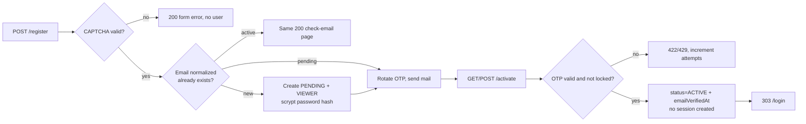
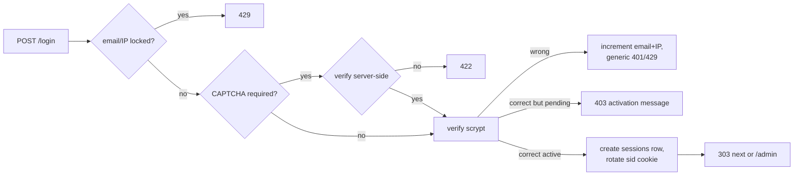
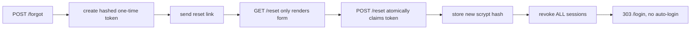
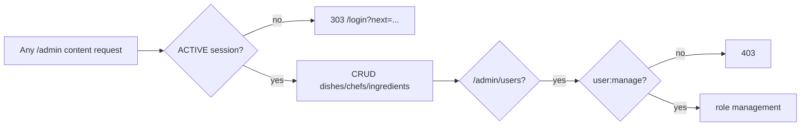

# Block 8 — Local Authentication Evidence

This folder documents the implementation of Block 8 (registration, activation, login, sessions, logout, password reset, and authenticated CRUD).

> [!IMPORTANT]
> - **Full Submission Evidence Report:** See [EVIDENCE_REPORT.md](./EVIDENCE_REPORT.md) for full flowcharts, masked database records, direct requests (curl), and UI screenshots for all 6 required scenarios.
> - **Agent Bug Report (Requirement 4):** See [agent-bugs.md](./agent-bugs.md) for reproduction steps and evidence of agent-introduced bugs.

## Architecture summary









## Acceptance matrix

| Requirement | Implementation | Evidence |
| --- | --- | --- |
| Register requires CAPTCHA before user/hash/mail | `src/auth/routes.ts` register handler, `src/lib/captcha.ts` | Test: `tests/auth-login.test.ts` |
| Normalize email and unique lookup | `src/auth/email.ts`, `prisma/schema.prisma` `email_normalized` unique | Migration + DB query |
| Default role viewer, ignore body role | `RegisterSchema` has no role; profile create uses `VIEWER` | Test: registration payload |
| Same response for new/existing email | `renderCheckEmail` both branches | Test: existing active email |
| OTP hash, TTL, attempts, lock, resend | `ActivationChallenge`, `src/auth/activation.ts` | Tests: `tests/auth-activation.test.ts` |
| Activation does not auto-login | No session creation in `/activate` | Test: activation 303 `/login` |
| Pending cannot log in | `status !== ACTIVE` branch before session | Test: pending login |
| Server-side session `sid` | `sessions` table, `src/auth/session.ts` | DB row after login |
| Logout revokes old sid | `revokeSession` + cookie clear | Test: logout |
| Login 303 and generic error | login handler | Test: success 303, wrong 401 |
| CAPTCHA after 3 / lock after 10 | `src/auth/login-attempts.ts` | Tests: login policy |
| Counter keyed by email + IP | `attemptKeys(email, ip)` | Tests: `tests/login-attempts.test.ts` |
| CSRF on forms | `csrf-csrf`, `_csrf` in views | `tests/auth-*`; manual form post |
| All active users can use CRUD | `requireAuth` in content routers | `tests/admin-pagination.test.ts` plus guard tests |
| Unauthenticated CRUD → 303 | `requireAuth` | `tests/auth-session.test.ts` |
| scrypt password hashing | `src/auth/password.ts` | `tests/auth-login.test.ts`, manual hash test |
| Forgot/reset one-time token | `src/auth/password-reset.ts`, reset handler | `tests/auth-reset.test.ts` |
| Reset revokes all sessions | `revokeAllSessions` | `tests/auth-reset.test.ts` |
| Reset sends a "password changed" email (no password) | `sendPasswordChangedEmail` in reset handler | `tests/auth-reset.test.ts` |
| No auto-login after reset | redirect to `/login` | `tests/auth-reset.test.ts` |
| OTP/token/password not in response/log | templates only receive email/message; logs contain codes only | Manual Network tab |
| RLS for auth tables | `20261102133000_harden_local_auth_rls` | DB query `relrowsecurity` |

## Manual evidence checklist

Capture these screenshots or terminal output for the report:

1. Network tab of `POST /register`: response is the check-email page, no OTP/password in body.
2. Mailbox screenshot showing the 6-digit OTP.
3. `sessions` table row after login, with `sid_hash`, `user_id`, `expires_at`.
4. Browser Application tab: `sid` cookie is `HttpOnly`; `document.cookie` does not expose it.
5. Logout then Back/refresh an open `/admin` tab: request returns `303 /login`.
6. Re-use the old `sid` value in a cookie jar: request is anonymous.
7. Three wrong logins: CAPTCHA appears on the fourth attempt.
8. Ten wrong logins: `429` even with a valid CAPTCHA.
9. Clear cookies / open a private window and continue guessing: counter remains locked (server-side email/IP keys).
10. Forgot password for existing and missing emails: same `200` body.
11. Reset link used twice: second `POST` returns invalid, password unchanged.
12. Reset while logged in elsewhere: old sessions are revoked.
13. `POST /admin/dishes` without login: `303 /login`; with a viewer account: succeeds.
14. `POST /admin/users/:id/role` as viewer: `403`; as admin: succeeds.
15. DB query: `sessions`, `activation_challenges`, `password_resets` have RLS enabled.

## Useful commands

```powershell
npm run typecheck
npm test
npx prisma migrate deploy
```

Inspect auth tables (replace `<user-id>`):

```sql
select user_id, expires_at, revoked_at from sessions order by created_at desc limit 5;
select user_id, attempts, locked_until, last_sent_at, used_at from activation_challenges;
```

## Known scope notes

- Block 8 uses login-only content CRUD. `VIEWER` still has no `user:manage`; detailed role permissions are a Block 9 concern.
- Login counters are in-process memory (single Node process, as used by the coursework). Sessions and activation state are in PostgreSQL.
- SMTP must be configured; without `SMTP_HOST`, registration returns a clear 500 instead of printing an OTP to logs.